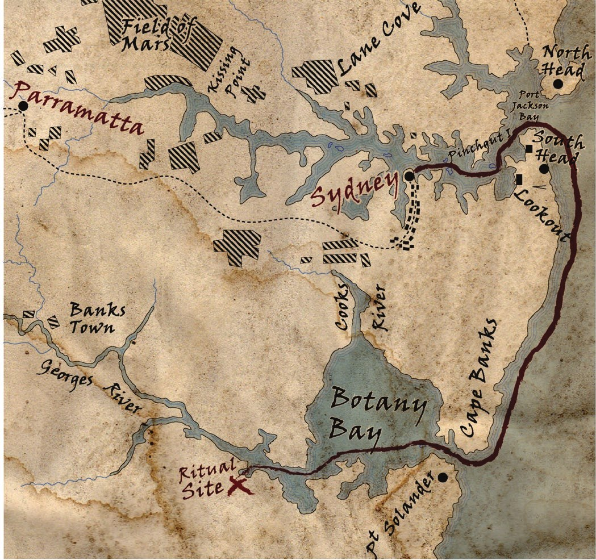

*Подписи на карте (сверху вниз, слева направо):*

- *Field of Mars* — Марсово поле
- *Parramatta* — Парраматта
- *Kissing Point* — Киссинг-Пойнт
- *Lane Cove* — Лейн-Ков
- *North Head* — Норт-Хед (Северный мыс)
- *Port Jackson Bay* — залив Порт-Джексон
- *Pinchgut I.* — остров Пинчгат
- *South Head* — Саут-Хед (Южный мыс)
- *Sydney* — Сидней
- *Lookout* — наблюдательный пост
- *Banks Town* — Бэнкс-Таун
- *Cooks River* — Кукс-Ривер
- *Georges River* — река Джорджес
- *Botany Bay* — Ботани-Бей
- *Cape Banks* — Кейп-Бэнкс
- *Ritual Site* — место ритуала
- *Pt Solander* — мыс Соландер

*Тёмная красная линия — курс судна Чарльза.*

# Роща у реки Джорджес

Если судну сыщиков удастся проследовать за судном Чарльза вверх по реке Джорджес, станет ясно, что каторжное судно бросило якорь у излучины реки, рядом с грубо сколоченной деревянной пристанью. Это шаткое временное сооружение построили каторжники Чарльза, но оно оказалось (едва-едва) достаточно прочным, чтобы выгрузить колокола на простую деревянную телегу.

Местность за пристанью холмистая, и разглядеть, что лежит дальше, трудно.

Если сыщики прибудут некоторое время спустя после каторжного судна, и судно, и причал окажутся брошенными. Высадившись на берег (скорее всего, на шлюпках), они увидят отчётливые колеи от телеги, которую тащили вверх по травянистым холмам за пристанью. Чтобы пройти по ним, проверки не нужны; после короткого, но изнурительного перехода сыщики выходят в зелёную рощу, укрытую эвкалиптами. Все люди с судна Чарльза находятся в этой роще вместе с колоколами.

Самое заметное в роще — глубокая яма в земле: в лунном свете кажется, что она уходит вниз очень далеко. Ещё одна примечательная черта поляны — деревянное сооружение,
