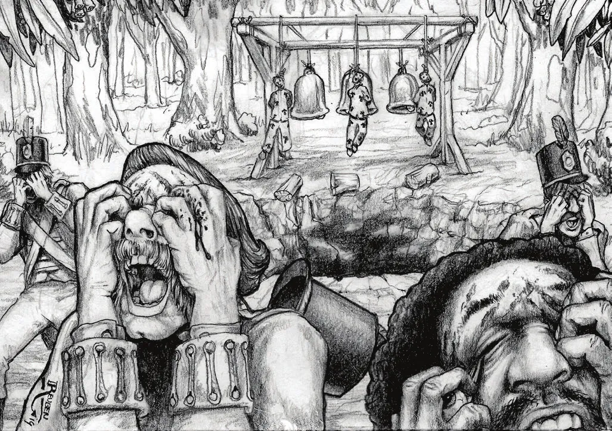

# Награды и потери

Если сыщикам удастся сорвать ритуал Чарльза, они вернут часть пошатнувшегося рассудка; тех, кто одолел одну или несколько Живых Ночных Теней, ещё больше ободрит изгнание такого зла.

Если Тварь из Ямы явится, но сыщики её одолеют, они тоже вернут толику рассудка. Однако если они позволят твари навсегда остаться на земле, Чарльз будет упиваться разрушительной силой, навлекая беспросветную тьму на обжитые места Нового Южного Уэльса одно за другим. Каждую неделю в Сидней будут приходить вести о том, что на какой-то городок опустилась таинственная тьма, а людей там находят с глазами, выколотыми собственными руками. Каждая такая весть — умеренное потрясение. Если Тварь целый месяц будет действовать беспрепятственно, безумный Чарльз Седжвик направит свою разрушительную тьму на сам Сидней — такой исход станет для сыщиков потрясением посерьёзнее… но если в это время они ещё будут в Сиднее, это может оказаться наименьшей из их бед.

# Характеристики

*Из-за лицензионных ограничений игровые характеристики в этой версии «Отпускного билета» № 15 опущены. Чтобы получить версию файла с полными характеристиками для старейшей лавкрафтовской ролевой игры, зайдите на www.cthulhureborn.com/download и найдите «Ticket of Leave #15 (Statted Version)».*

### Сержант Чарльз Седжвик*

*Флейтист Корпуса Нового Южного Уэльса и безумец, 48 лет.*

```stat
* ПРИМЕЧАНИЕ: рядом с одним или несколькими покрытыми надписями
колоколами он связан с магической силой всех вызванных Живых
Ночных Теней и перенимает их силу (если она больше его
собственной; действует, пока Ночные Тени остаются в нашем
измерении, а Чарльз находится рядом с колоколами).

Оружие: сабля, кремнёвый пистолет × 2, карабин.

Заклинания: магия мысленного подчинения, Зачаровать ритуальный
колокол, Призыв Твари из Ямы.
```
