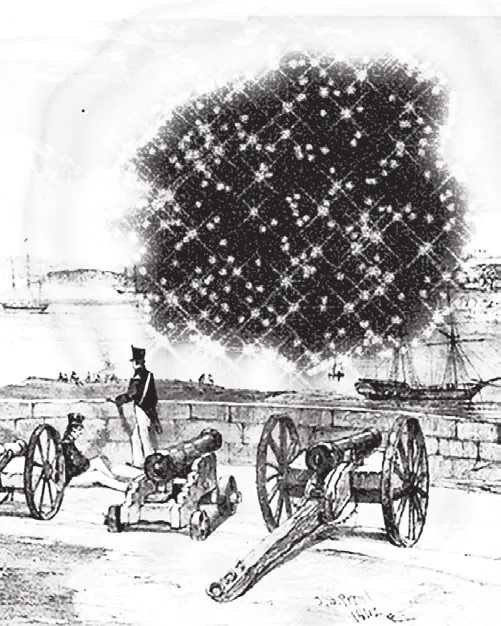

**Уязвимость к огню и сильному жару.** Огонь или сильный жар (температура выше 66 °C) автоматически ранит Живых Ночных Теней. Эти сущности бегут от любых таких источников огня или жара.

**Привязаны к колоколу.** Каждая Ночная Тень тесно связана с одним из зачарованных колоколов. Всякий раз, когда в этот колокол звонят, Ночная Тень должна немедленно вернуться к звенящему металлу. Если колокол уничтожить, Ночная Тень рассеется в ничто.

**Во имя их бога.** Живых Ночных Теней призывает в это измерение звон колокола, посвящённого их чуждому богу. Отправить их обратно в родное измерение может любой, кто прикажет им уйти, призвав имя их бога (например, «изыди во имя Зу-Чекуона» или что-то подобное). Всякий, кто в этот миг касается Ночной Тени или окутан её чёрным паром, тоже перенесётся в её обиталище в ином измерении.

### Тварь из Ямы

Тварь, которую Мэтью Седжвик желает вызвать из ямы, — невероятно могущественная чуждая сущность, вероятно, один из Великих Древних. Разные тома Мифов называют эту невозможную и ужасную разумную тьму по-разному: одни — Зу-Чекуон, другие — Шушикуан. Все источники описывают её как всепоглощающую чернильную черноту, которую из глубин под землёй вызывает звон особых больших колоколов, покрытых ритуальными надписями.

*Прим. перев.:* вызвать Тварь желает, конечно, Чарльз Седжвик, а не Мэтью — опечатка книги.

Её приходу предшествует потусторонний холод и неестественная резь в глазах у людей и разумных животных. Эта мучительная резь так сильна, что, как известно, некоторые выкалывали себе глаза, лишь бы она прекратилась. Явленный облик Твари из Ямы бесплотен, но соприкосновение с её тьмой может вызвать у жертв разрушительные телесные последствия.

**Ослепление.** Всякий, кого поглотит чуждая тьма Твари из Ямы, временно слепнет — пока остаётся внутри чернильной черноты. Внутри Твари гаснет всякий звук: там царит полная тишина, и говорить друг с другом невозможно. Это до ужаса противоестественное состояние. Если потрясение от соприкосновения с этой безотрадной, холодной и чёрной реальностью слишком велико для человека, он сходит с ума и немедленно пытается выколоть себе оба глаза.

Даже если удастся избежать столь жуткой участи, слепота и глухота, испытанные во время соприкосновения, могут остаться навсегда: когда пострадавший наконец освободится от чёрного влияния Твари, у него может остаться истерическая слепота или истерическая глухота (на выбор Хранителя). Чтобы излечиться от таких «конверсионных расстройств», может понадобиться лечение.

**Существо колоколов.** Вызванная на поверхность земли Тварь мистически связана с покрытыми надписями колоколами, которыми пользовались в ритуале её призыва. Пока они (и вырезанные на них надписи) целы, Тварь может оставаться на земле. Если уничтожить один или несколько колоколов (или испортить надписи на них), она будет вынуждена снова уйти под землю. Даже изгнанная таким образом, Тварь из Ямы сохраняет некоторую связь с местом, где её вызвали, и ненадолго возвращается туда при каждом полном солнечном затмении.

**Броня.** Тварь из Ямы не получает урона ни от физической силы, ни от света. Магия действует на неё как обычно. Она уязвима и для зачарованного оружия, но получает от него минимальный урон.

## Дополнительное чтение

Хранитель может найти дополнительные исторические сведения о музыке раннего каторжного поселения и в некоторых других местах. Ниже приведено несколько избранных источников.
