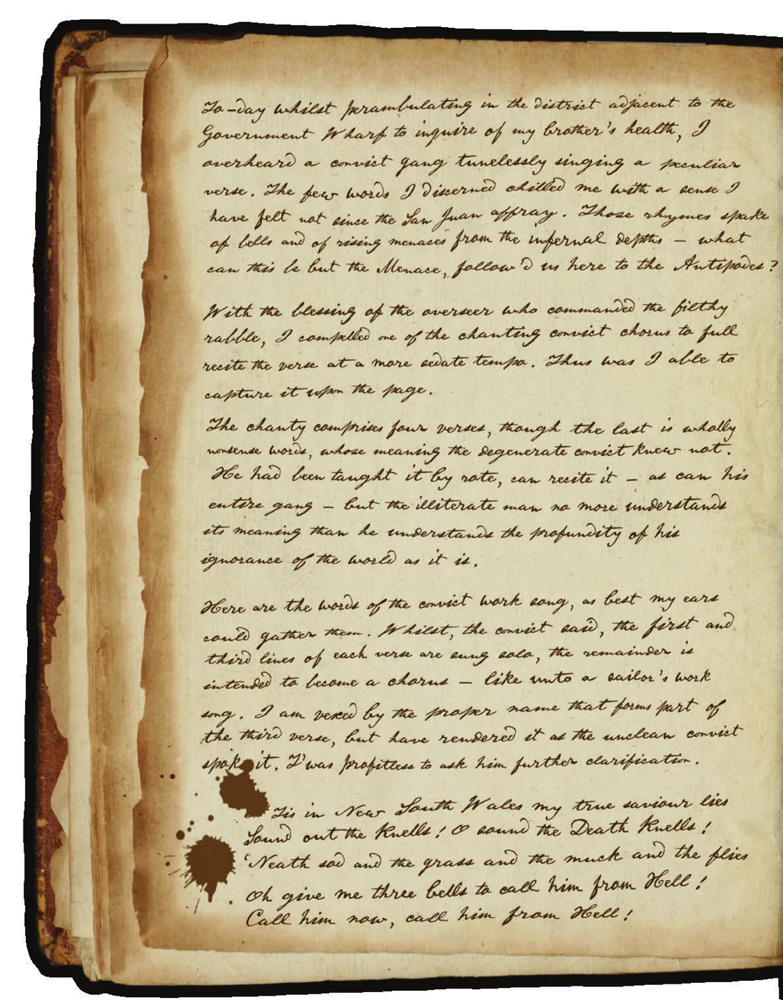

*Сбоку страницы: «Выдержка из дневника Мэтью Седжвика (раздаточная версия, эта и следующая страницы)».*

> **Раздатка: Выдержка из дневника Мэтью Седжвика (лист 1)**
>
> Сего дня, прогуливаясь в округе близ Правительственной пристани, дабы справиться о здоровье брата моего, я услышал, как каторжная бригада немелодично распевает странный стих. Те немногие слова, что я разобрал, обдали меня холодом, какого я не чувствовал со времён сан-хуанской стычки. Те рифмы говорили о колоколах и о грозах, восстающих из адских глубин, — что же это может быть, как не Угроза, последовавшая за нами сюда, к Антиподам?
>
> С благословения надсмотрщика, командовавшего этим грязным сбродом, я заставил одного из поющих каторжников полностью прочесть стих в более спокойном темпе. Так я смог записать его.
>
> Шанти состоит из четырёх куплетов, хотя последний — сплошь бессмысленные слова, смысла которых выродок-каторжник не знал. Его выучили наизусть, он может прочесть её — как и вся его бригада, — но неграмотный этот человек понимает её смысл не больше, чем глубину своего невежества о мире, каков он есть.
>
> Вот слова каторжной рабочей песни, как мои уши смогли их уловить. Первые и третьи строки каждого куплета, сказал каторжник, поются соло, а остальное должно стать хором — подобно матросской рабочей песне. Меня тревожит имя собственное в третьем куплете, но я записал его так, как произнёс его нечистый каторжник. Бесполезно было просить у него дальнейших разъяснений.
>
> *О, в Новом Южном Уэльсе мой истинный спаситель лежит, 
> Звоните по мёртвым! О, бейте похоронный звон! 
> Под дёрном, травой, под грязью, где муха жужжит, 
> О, дайте мне три колокола — призвать его из ада вон! 
> Зовите его, зовите из ада вон!*
