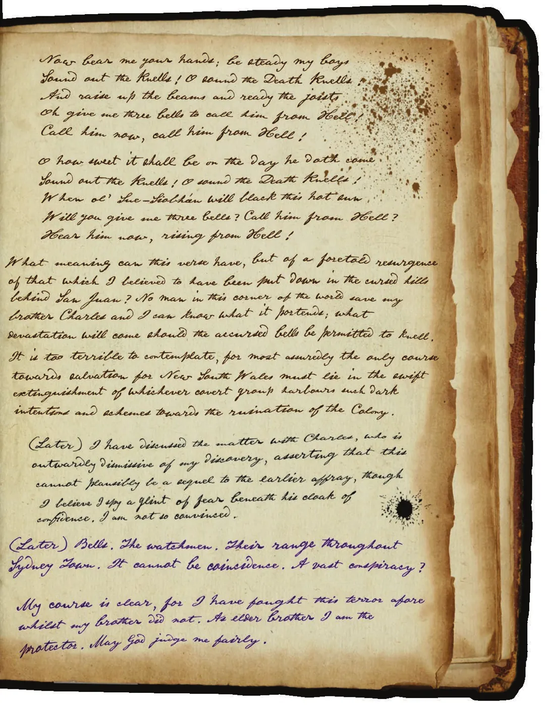

> **Раздатка: Выдержка из дневника Мэтью Седжвика (лист 2)**
>
> *Ну, руки ко мне; держитесь, ребята, дружней, 
> Звоните по мёртвым! О, бейте похоронный звон! 
> Поднимайте балки, готовьте брусья скорей, 
> О, дайте мне три колокола — призвать его из ада вон! 
> Зовите его, зовите из ада вон!*
>
> *О, как сладко будет в день, когда он придёт, 
> Звоните по мёртвым! О, бейте похоронный звон! 
> Когда ол’ Сью-Шивон это жаркое солнце зачернёт, 
> Дадите мне три колокола? Призвать его из ада вон? 
> Слышите, он восстаёт из ада вон!*
>
> Какой смысл может быть у этого стиха, кроме предсказанного возвращения того, что я считал подавленным в проклятых холмах за Сан-Хуаном? Никто в этом уголке мира, кроме меня и брата моего Чарльза, не может знать, что он предвещает, какое опустошение придёт, если проклятым колоколам позволят звонить. Слишком страшно и помыслить, ибо вернейший путь к спасению Нового Южного Уэльса, несомненно, лежит в скорейшем истреблении той тайной группы, что лелеет столь тёмные намерения и замыслы на погибель Колонии.
>
> (Позже) Я обсудил это с Чарльзом, который внешне отмахнулся от моего открытия, утверждая, что это никак не может быть продолжением прежней стычки, хотя мне кажется, я различаю отблеск страха под его плащом уверенности. Я не так уж убеждён.
>
> (Позже) Колокола. Сторожа. Их обходы по всему Сиднею. Это не может быть совпадением. Огромный заговор? Мой путь ясен, ибо я уже бился с этим ужасом, а мой брат — нет. Как старший брат, я — защитник. Да судит меня Бог по справедливости.

*На оригинале последняя запись («(Позже) Колокола. Сторожа…») сделана другими, фиолетовыми чернилами.*
