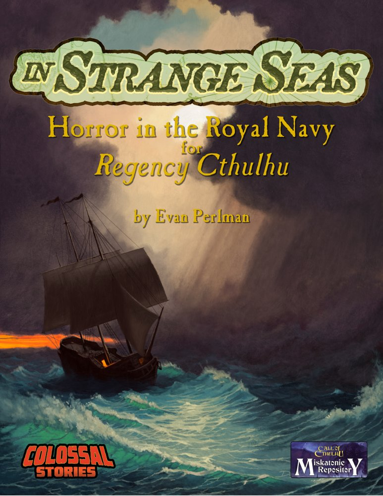

В СТРАННЫХ МОРЯХ

Ужас на Королевском флоте

для <i>Regency Cthulhu</i>

Эван Перлман

*На обложке — парусный корабль в бурном море под грозовыми тучами, сквозь которые пробивается свет; вверху — название «In Strange Seas» и подзаголовок «Horror in the Royal Navy for Regency Cthulhu», имя автора (by Evan Perlman); внизу — логотипы Colossal Stories и «Call of Cthulhu — Miskatonic Repository». Иллюстрация © Dean Spencer.*
