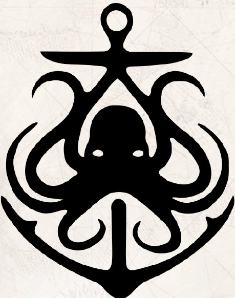

# Выходные данные

*Аманде, как всегда. А также Счастливчику Джеку и Стивену, навеки плывущим в нашем воображении.*

«В странных морях» (*In Strange Seas*) — общий проект. Кроме этого руководства по сеттингу, есть и несколько сценариев, выпущенных в линейке *In Strange Seas*, и время от времени выходят новые. Ищите «In Strange Seas» на DriveThru RPG и следите за новинками в «живом» документе мира *Gazette* (ссылка — в оригинале).

Руководство написал Эван Перлман (Evan Perlman).

Вёрстка — Алекс Гийотт (Alex Guillotte) и Эван Перлман.

Часть иллюстраций © Дин Спенсер (Dean Spencer), используются с разрешения, все права защищены: это иллюстрация на обложке и рисунок кракена на с. 11.

Логотип-надпись *In Strange Seas* создал для проекта Крис Хут (Chris Huth).

Логотип «осьминог на якоре» — работа пользователя *Nizips* с OpenClipart.org, щедро переданная в общественное достояние.

Все остальные иллюстрации — общественное достояние.

---

*Call of Cthulhu* («Зов Ктулху») — товарный знак Chaosium Inc., используется с её разрешения по программе OBS Community Content. Подробнее — на сайте Chaosium: www.chaosium.com

*In Strange Seas: Horror in the Royal Navy for Regency Cthulhu* («В странных морях: ужас на Королевском флоте для Regency Cthulhu») © 2023 Эван Перлман.

*Не для перепродажи. Разрешается печатать и копировать этот документ только для личного использования.*
