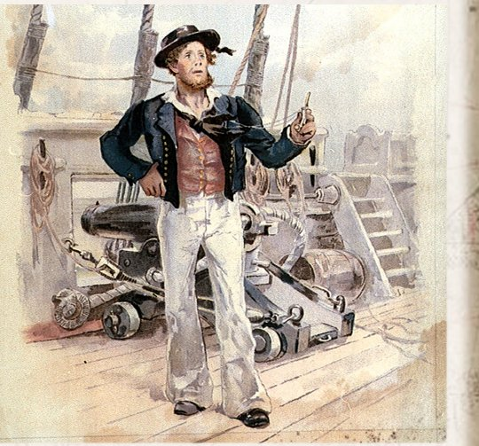

его из вежливости называют «капитаном». Конечная цель лейтенанта — «получить пост», то есть патент на чин пост-капитана, и стать настоящим капитаном.

Мичманы, которых зовут также «юными джентльменами», считаются учениками офицеров. Они учатся ремеслу командования и служат на борту не меньше шести лет, пока не сдадут экзамен по разным сторонам морского дела. Экзамен принимает комиссия из трёх капитанов; сдавший его мичман становится лейтенантом.

> **Сексизм и гомофобия на флоте**
>
> Исторический Королевский флот строго запрещал женщинам находиться на борту, если они не были приглашёнными пассажирками.
>
> Неофициально, однако, некоторые женщины всё же жили и даже служили на кораблях: есть много свидетельств, что женщины помогали стрелять из корабельных пушек в бою, присматривали за корабельными юнгами и делали другую работу наравне с мужчинами экипажа.
>
> Официально флот столь же нетерпимо относился к связям между мужчинами и назначал пойманным смертную казнь.
>
> Но сексистских и гомофобных правил исторического флота во «В странных морях» нет. Люди любого пола и ориентации должны служить на борту в любой роли. Персонажи Хранителя из «живого» документа мира «Gazette» — как раз разнообразный круг людей.
>
> В игре, где люди всех полов служат вместе на одном корабле, флот может ввести правило, похожее на правило современных флотов: запрет на связи и ухаживания между членами экипажа разного чина — чтобы на борту не было злоупотребления властью, ревности и обид.

### Уорент-офицеры

Уорент-офицеры — знатоки отдельных сторон управления кораблём; это своего рода «технические» должности. Сюда входят штурман (sailing master, или просто master), канонир, боцман, плотник, казначей, хирург и другие.

«Постоянные офицеры» — канонир, боцман и плотник. Их так зовут потому, что они обычно остаются на корабле, пока другие офицеры приходят и уходят или следуют за капитаном на новое назначение. Постоянных офицеров ценят за морское мастерство; лестницы продвижения, о которой стоило бы беспокоиться, у них, по сути, нет — разве что им дадут место на корабле побольше и попрестижнее.

У уорент-офицеров есть один или несколько «помощников» (mates), часто из простых матросов или мичманов. Помощник может однажды сам стать уорент-офицером, поэтому для простого матроса это ценное повышение.

Уорент-офицерам помогают разные унтер-офицеры. Например, у канонира — оружейник, у боцмана — парусный мастер, у штурмана — квартирмейстер, у плотника — конопатчик.

### Простые матросы

Подавляющее большинство экипажа — простые матросы. Матроса «записывают в первую статью» (rated able), когда он освоил главные морские навыки. Неумелых — например, новичков на флоте или тех, кто не способен научиться, — по-прежнему ставят на тяжёлую работу: таскать грузы, тянуть канаты, драить палубы и тому подобное.

Членов экипажа других занятий зовут «бездельниками» (idlers): они работают с утра до вечера, а не по очереди вахт. На корабле это, например, писарь, стюард, кок, цирюльник, мясник или капеллан.

Кто-то на борту — настоящие пассажиры: дипломаты, натурфилософы или офицеры, которых подвозят в другой порт. На кораблях обычно есть и отряд морской пехоты со своим капитаном морской пехоты. Наконец, на борту могут быть дети — слуги офицеров, набирающие морской стаж, чтобы стать мичманами.

Рекомендуемое происхождение и навыки для многих видов моряков — ниже, в разделе «Сыщик на флоте».

> **Зацепка Мифов: Неведомый пассажир**
>
> На корабле Его Величества «Призрак» (HMS Wraith) есть невидимое присутствие, и многие моряки ломают головы над «призраком на старом „Призраке“». Каждый уверяет, что видел его, но двух одинаковых рассказов нет. Точно так же все согласны, что это знамение, но к добру оно или к худу, никто сказать не может.

## Поступление на флот

На флот попадают разными путями, и не всегда добровольно. Если семья может это устроить, будущие офицеры обычно поступают совсем юными, часто до 12 лет, — слугами к офицерам. Меньшая часть вместо службы в море учится в Королевской военно-морской
