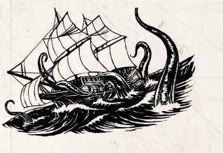

«вылазки за призом» (cutting-out expeditions) — чтобы увести вражеский корабль из гавани — и сухопутные атаки, чтобы взять город или взорвать укрепление.

## Смерть, хвори, пьянство и другие опасности

При стольких способах покалечиться, заболеть или погибнуть корабельный хирург занят всё плавание. В обычной работе на корабле моряку может раздавить палец на руке или ноге тяжёлым блоком, он может сорваться с такелажа или упасть за борт и рискует утонуть.

У прослуживших сколько-нибудь долго моряков часто не хватает зубов или глаза, они туговаты на ухо от пушечной стрельбы и могут быть сильно обожжены солнцем или глубоко загорелыми.

В начале плавания моряки могут болеть тифозной лихорадкой

> **Зацепка Мифов: Вспышка мора**
>
> На флагмане адмирала Форрестера на якорной стоянке Спитхед появилась новая болезнь. Хирург флота думает, что это какая-то оспа, но никогда не видел таких странных чешуйчатых образований на коже. Не сверхъестественное ли это оружие — быстро распространяющаяся, быстро убивающая зараза, которая грозит уничтожить флот на стоянке?

или одной из разных венерических болезней, подхваченных на берегу. После долгого пребывания в море у моряков может начаться цинга, если их слишком долго лишали лаймов или свежих овощей.

И конечно, в бою моряка могут застрелить из пистолета или мушкета, заколоть саблей или абордажным топором, разорвать картечью или щепками от ядра или раздавить падающим такелажем.

Непривычным к морю всегда грозит морская болезнь, а тем, кто никогда не видел боя, — временное безумие при виде бойни на палубе.

Погибших в бою иногда быстро сталкивают за борт, чтобы расчистить палубу.

Если обстоятельства позволяют похороны, по обычаю товарищи по бачку зашивают погибшего в парусиновый мешок, утяжелённый ядрами. Вся команда собирается на похоронную службу, капитан или капеллан говорят несколько слов, и тело с большой торжественностью предают морю.

Позже одежду погибшего часто продают тем из экипажа, кто в ней нуждается.

## Матросские суеверия

При бесконечном множестве способов покалечиться или погибнуть неудивительно, что у моряков сложился огромный свод суеверий.

Например: свист или царапанье фок-мачты вызывает ветер; призраки, ведьмы и русалки существуют; священник на борту приносит несчастье; «Иона», то есть очень невезучий человек, может погубить весь корабль; кошки приносят удачу; кошки приносят несчастье; альбатросы приносят удачу, и вредить им нельзя; буревестники — души погибших моряков; отплывать в пятницу — к несчастью; и многое другое.

Для моряков, чья жизнь часто состоит из долгой однообразной тяжёлой работы и коротких, крайне смертоносных событий, любое необычное событие, предмет или наблюдение приобретает сверхъестественное или суеверное значение. Бывало даже, что раненые моряки хранили свои ампутированные пальцы рук или ног — высушенными и сохранёнными — на удачу.

## Дисциплина, наказания и бунт

Капитан, офицеры и экипаж — все участвуют в поддержании ожиданий от поведения и умения. Неофициальную дисциплину можно поддерживать тихим, но недвусмысленным замечанием товарища или публичным разносом от офицера.

Для официальной дисциплины Военные статьи дают капитану огромную власть наказывать моряков, но и у неё есть пределы и обычаи. На разных кораблях дисциплину применяют по-разному. Одни капитаны полагаются на суровость, другие стараются заслужить уважение и преданность личным примером, но наказания в той или иной мере неизменно бывают на каждом корабле.

По Военным статьям лёгким наказаниям подлежат сквернословие и пьянство, подстрекательство к беспорядкам, ссоры и драки, а также разряд «всех прочих преступлений, не караемых смертью». Другие проступки — сношения с неприятелем, неисполнение приказов, уклонение от боя с неприятелем, дезертирство, бунт, недопустимые половые действия, насилие или неповиновение старшему — могут караться смертью. Однако смертный приговор выносит только военный суд, и капитаны часто прибегают к меньшим наказаниям, например к порке.

Другие наказания для простых матросов — лишение грога и заковывание в кандалы. Мичмана могут отправить на несколько часов на мачту, а в крайних случаях разжаловать — на время сделать простым матросом.

Бунты, когда случаются, обычно бывают ответом на чрезмерно суровые или своевольные наказания. Большие бунты на якорных стоянках Спитхед и Нор в 1797 году были из-за дисциплины, условий труда и требования больше увольнений на берег, а не из-за низкого жалованья, к которому привыкли все моряки.

