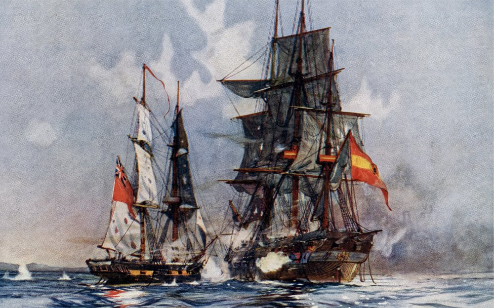

> **Зацепка Мифов: Бунт на «Ардженте»**
>
> По всем рассказам, «Арджент» (HMS Argent) был счастливым кораблём. Почему же его экипаж вдруг взбунтовался и жестоко перебил своих офицеров?
>
> Бунтовщики разбежались по всему свету, а других выживших никак не удаётся разговорить. Сыщики должны выследить бунтовщиков и узнать, что толкнуло их на такое необъяснимое безумие и насилие.

## Адмиралтейство

Королевским флотом руководит Адмиралтейство, которое помещается в довольно скромном здании в Уайтхолле, в Лондоне.

Во главе — министр, Первый лорд Адмиралтейства: это политическая должность, и её занимает не всегда человек с прямым опытом флотского офицера.

В Совет Адмиралтейства входят Первый лорд и ещё пять-шесть членов с разным знанием флотского дела. Совет Адмиралтейства, кроме прочего, ведает продвижением и назначениями офицеров.

Под этим советом — Морской совет (Naval Board), который ведает более повседневными и техническими делами и назначает уорент-офицеров. Другие советы отвечают за снабжение провиантом и снаряжением и за заботу о больных и раненых моряках.

Часть умений офицера — умение ладить с разными людьми, от которых зависит её судьба: от капитана и офицеров, заведующих местной верфью снабжения, до старших офицеров, которые могут решать о её продвижении и назначениях.

Адмиралтейство — высший источник продвижения и потому распоряжается успехом или неудачей своих офицеров. Офицеру, нажившему врага в Адмиралтействе или Морском совете, стоит готовиться к ненастью.

Заметьте, что «Адмиралтейство» как учреждение — не то же самое, что люди, ставшие адмиралами флота. Адмиралы в море обычно командуют эскадрой или частью эскадры, обозначенной цветом: красная, белая и синяя. Поднимаясь по старшинству, моряк становится контр-адмиралом, затем вице-адмиралом, затем адмиралом той или иной эскадры или даже адмиралом флота.

Как и все старшинства после чина пост-капитана, производство в адмиралы — во многом вопрос того, чтобы остаться в живых, пока старшие умирают или уходят в отставку. Но некоторые менее удачливые пост-капитаны, став адмиралами, навсегда остаются на берегу без командования. Их называют «жёлтыми адмиралами» — по несуществующей «жёлтой эскадре», к которой они будто бы приписаны.

