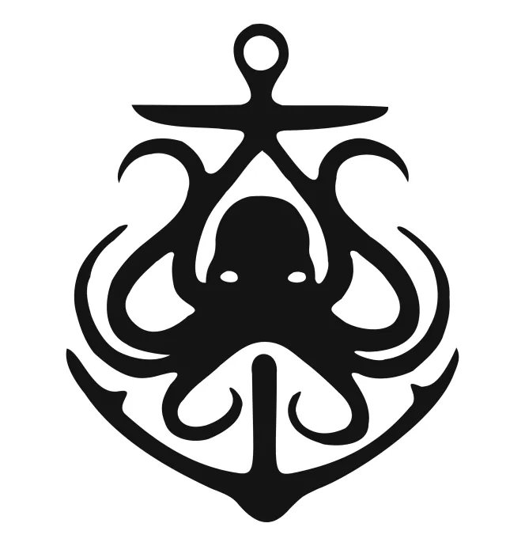

# Типы кораблей и их назначение

По некоторым данным, перед самым началом войны с Францией у Королевского флота было больше 660 военных кораблей, в том числе почти 200 линейных кораблей и больше 200 фрегатов.

### Линейные корабли

Линейные корабли, или корабли «линии баталии», обычно большие и полные пушек: они должны выстраиваться в буквальную линию кораблей против неприятеля в таком же строю и вышибать друг друга из воды в больших захватывающих сражениях флотов.

Однако многие линейные корабли Королевского флота несут блокадную службу. Это однообразная, изнурительная, неблагодарная служба: каждый корабль месяцами в любую погоду держит позицию у крупных французских портов.

Названия разрядов со временем меняются и не всегда последовательны, но на меньшем краю этой категории — корабли «третьего ранга», обычно с 64 или 74 пушками на двух палубах. К концу Наполеоновских войн у крупнейших кораблей «первого ранга» 100 пушек на трёх палубах.

### Фрегаты

Для вольных приключений ничто не сравнится с фрегатом. Фрегаты меньше и манёвреннее линейных кораблей; формально это корабли «пятого ранга», обычно с 28 пушками, стреляющими 18-фунтовыми ядрами. В отличие от линейных кораблей у фрегатов все пушки на одной палубе, а номинальная «орудийная палуба» служит жильём экипажа.

*Прим. перев.: книга описывает фрегаты по-разному: здесь — 28 пушек на одной палубе, в приложении (с. 24) у типичного фрегата 38 пушек (28 — на верхней палубе), а у «Калибана» (с. 25) — по 16 больших пушек с каждого борта на крытой орудийной палубе. Книга сама оговаривает, что устройство кораблей сильно различалось.*

Фрегаты обычно ходят в одиночку, ведут разведку или крейсируют в поисках отдельных вражеских кораблей, чтобы с ними сразиться. Они много воюют, и многие капитаны сделали себе имя и состояние на шканцах фрегата.

### Малые военные корабли

Меньше фрегата — корабли вне ранга, обычно разные виды «военного шлюпа»: как правило, 18 пушек или меньше и одна или две мачты. Их часто используют против каперов, пиратов и работорговцев и для захвата беззащитных торговых судов.

Ими обычно командуют лейтенанты в роли «мастер-коммандера»: по праву пост-капитан должен командовать кораблём ранга, и командовать шлюпом ему не пристало.

Другие суда, например быстроходные балтиморские клиперы, иногда служат на флоте, если их захватили или купили.

Бесконечное множество типов кораблей и немыслимая сложность того, как корабли описывали и классифицировали на флоте, выходят за рамки этого руководства.

В приложениях — примеры основных описанных выше типов кораблей: размеры, численность экипажа, число и вид пушек, а также экскурсия по типичному фрегату — кораблю Его Величества «Калибан».

