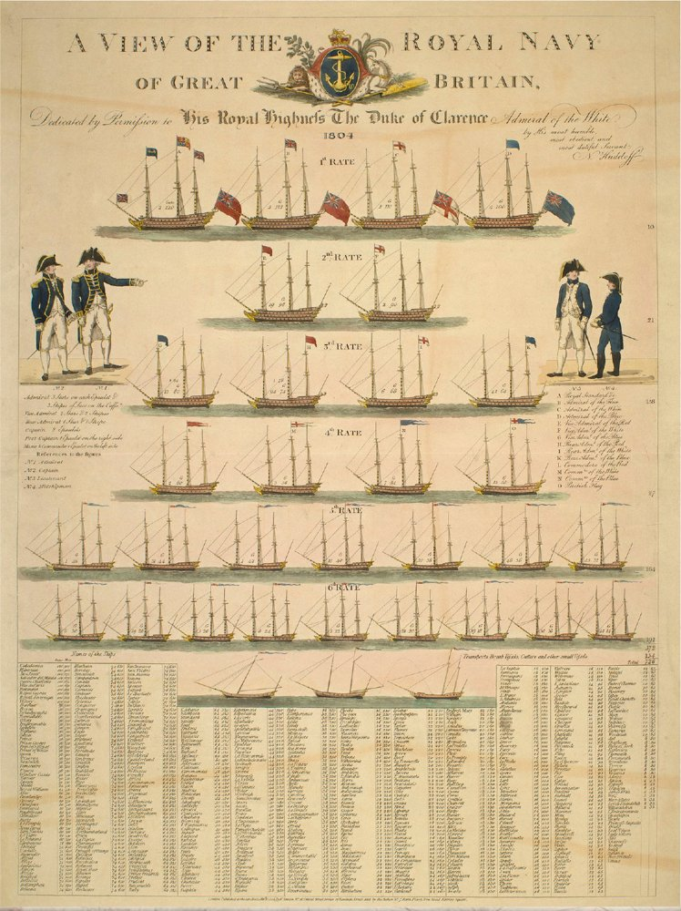

*На полностраничной гравюре 1804 года, посвящённой «с дозволения» Его Королевскому Высочеству герцогу Кларенсу, адмиралу белой эскадры, — корабли Королевского флота по рангам, с первого по шестой (1st Rate … 6th Rate); по сторонам — фигуры офицеров в мундирах разных чинов с пояснениями; внизу — мелкие списки названий кораблей по рангам и малых судов. Мелкий текст гравюры не переводится.*
