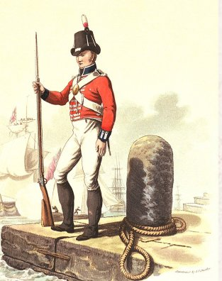

Офицерам без независимого состояния — по чину:

- *Пост-капитан:* Средства 30–49 (£16.16.0 в месяц); полоса дохода 2
- *Лейтенант:* Средства 10–29 (£8.8.0 в месяц); полоса дохода 1
- *Мичман:* Средства 5–15 (£2.0.6 в месяц); полоса дохода 1

**Навыки:** Астрономия, Этикет, один социальный навык, Ориентирование, Ближний бой (меч) или Стрельба (пушка), Лазание или Механика, Парусное дело, Внимание.

### Боцман

Боцман (boatswain) и её помощники отвечают за такелаж и паруса: следят, чтобы паруса, штаги, ванты, блоки и прочее были в порядке.

Боцман помогает и держать дисциплину. Она поднимает сонных при смене вахты, дудкой созывает людей на работы, а один из её помощников в дни наказаний исполняет порку.

**Пункты навыков профессии:** ОБР × 2 + СИЛ × 2

**Средства:**

- *Боцман:* 10–29 (£3.1.0 в месяц); полоса дохода 1
- *Помощник боцмана:* 5–10 (£1.16.6 в месяц); полоса дохода 1

**Навыки:** одно Искусство/ремесло, Лазание, Ближний бой (драка), Этикет, Запугивание, Механика, Парусное дело, Внимание.

### Корабельный плотник

Один из трёх «постоянных» уорент-офицеров. Плотник и его помощники отвечают за все главные деревянные части корабля: корпус, палубы, мачты и реи.

В бою или в скверную погоду их первая задача — найти и заделать пробоины и сильные течи под палубой и докладывать капитану, сколько воды на дне трюма; поэтому у них может быть навык Плавания. Команда плотника также убирает и ставит переборки, когда корабль готовят к бою.

**Пункты навыков профессии:** ОБР × 2 + ЛВК × 2

**Средства:**

- *Плотник:* 10–29 (£3.1.0 в месяц); полоса дохода 1
- *Помощник плотника:* 5–10 (£1.16.6 в месяц); полоса дохода 1

**Навыки:** Искусство/ремесло (плотницкое дело), Этикет, Механика, Естествознание, Парусное дело, Внимание, Плавание, один любой другой навык в зависимости от специальности и эпохи.

### Капеллан

Капеллан, или священник, заботится о духовных нуждах людей корабля, но его роль сильно разнится от корабля к кораблю в зависимости от отношения капитана к вере. Как минимум он обычно должен читать проповедь по воскресеньям, когда на палубе устраивают церковь, и часто — ободрять экипаж перед боем или в непогоду. Обычно он же учит молодняк на корабле, хотя математике и навигации их может учить и капитан.

**Пункты навыков профессии:** ОБР × 2 + МОЩ × 2

**Средства:** 30–49, ближе к верхней границе, если у него есть доход с прихода на суше (£11.10.9 в месяц); полоса дохода 2

**Навыки:** Антропология, История, Работа в библиотеке, два социальных навыка, Иностранный язык (например, латынь, греческий), Оккультизм, Психология.

### Канонир

Один из трёх «постоянных» уорент-офицеров. Канонир и его помощники ведают пушками корабля, ядрами, порохом и вооружением, в том числе ручным огнестрельным и абордажным оружием. Команда канонира следит, чтобы пушки и другое оружие всегда были готовы к делу и в порядке, а экипаж хорошо обучен.

**Пункты навыков профессии:** ОБР × 2 + ЛВК × 2

**Средства:**

- *Канонир:* 10–29 (£3.1.0 в месяц); полоса дохода 1
- *Помощник канонира:* 5–10 (£1.16.6 в месяц); полоса дохода 1

**Навыки:** один любой социальный навык, Уклонение, Этикет, Ближний бой (холодное оружие), Стрельба (мушкет), Стрельба (пушка), Механика, один любой другой навык в зависимости от специальности и эпохи.

### Морской пехотинец

На кораблях флота обычно есть хотя бы небольшой отряд морской пехоты. Морские пехотинцы помогают поддерживать порядок, стоя
