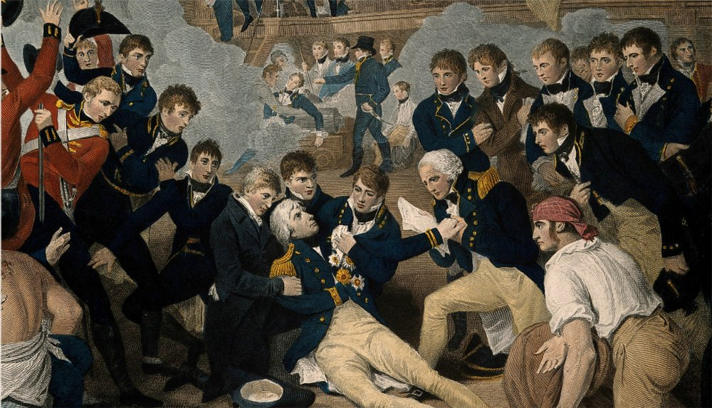

Моряки часто стремятся заработать Репутацию героическими поступками или исключительно достойным поведением. Кроме чрезвычайного успеха или лучше в проверке Этикета, моряки могут получить +10 пунктов Репутации за такие поступки:

- Тяжёлое ранение в абордажном бою.
- Победа в кулачном турнире всего флота.
- Суровое наказание, вынесенное без жалоб и крика.
- Похвала адмирала.
- Выстрел, который тяжело повредил вражеский корабль или ранил его капитана.
- Похвала капитана своему искусству или ремеслу.

## Сословия и чины в группе сыщиков

Как и в обычной игре *Regency Cthulhu*, играть сыщиками очень разных чинов может быть трудно. Во-первых, они вряд ли будут часто работать вместе. Во-вторых, и это важнее, чем дальше друг от друга их чины, тем стеснённее разговор. Баковый матрос почти никогда не может заговорить с капитаном, пока тот не заговорит с ним первым.

Если возможно, все сыщики должны быть примерно равного чина, чтобы есть за одним столом и иметь общую рабочую и общественную жизнь. Это могут быть все лейтенанты, или все мичманы в унылом мичманском кубрике, или все уорент-офицеры с помощниками, или все простые матросы.

Если чины смешанные, разумнее всего поместить всех в одну рабочую группу. Тогда, хоть они и будут есть и спать (иметь свои спальные места) порознь, они будут работать вместе достаточно часто, чтобы вместе расследовать тайны. Например, лейтенант, один-два мичмана, помощник штурмана или канонира и пара баковых матросов достаточно близки по чину, чтобы служить в одном дивизионе и в одних вахтах.

Кроме того, как и в отношениях хозяина и слуги на суше, игрок никогда не должен командовать другим игроком вне роли — даже если её сыщик может отдавать приказы, которые надо исполнять немедленно под страхом порки.

## Расширяйте мир

Сухопутная джентри может ничего не знать о мире за пределами своих поместий, лондонского дома на сезон и, может быть, дома кузена в Бате. А моряки видят весь мир. У них могут быть друзья на кораблях во всех морях и возлюбленные в каждом порту.

Контраст долгих периодов тесного одиночества в море и огромной сети друзей, врагов и знакомых создаёт для сыщиков «В странных морях» интересное напряжение.

