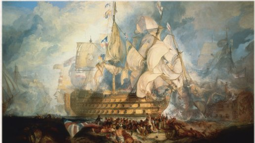

Хранителю стоит слухами, газетами, случайными встречами и перепиской рисовать картину огромного и деятельного мира за пределами крошечного деревянного королевства — корабля сыщиков. Неграмотный моряк может попросить грамотного товарища прочитать или написать письмо.

Каждый раз, когда корабль сыщиков встречает в море другой корабль или заходит в порт, сыщики должны узнавать какую-нибудь интересную новость. Письма из дома становятся драгоценностью. Объявления о рождениях и смертях помогают не терять связь с оставленным городом. Можно вспомнить старые времена со старым товарищем, служащим на другом корабле, или подраться со старым врагом в портовом трактире за полсвета от дома.

Другие слухи и новости Хранителю стоит брать из «Gazette» — «живого» документа мира (ссылка ниже). В «Gazette» — списки кораблей и персонажей Хранителя из других сценариев и дразнящие намёки на ужасные судьбы, которые могут их постигнуть. Моряки любят пугать друг друга до мурашек, и для этого нет ничего лучше сочной истории о жутком кораблекрушении или загадочной смерти!

«Gazette» — по ссылке **здесь** (в оригинале).

## Флот против Мифов

Флот в основном занят земными угрозами — кораблями Наполеона, разными каперами и пиратами, — но немногим невезучим кораблям порой выпадает столкновение с угрозами Мифов. Если сыщики Королевского флота переживут встречу с подлинно сверхъестественным, как это скажется на их жизни?

Хранителю стоит оставить в сценарии место для общественных последствий настоящей встречи с Мифами. Встречи с Мифами очень лично касаются каждого сыщика. Если у сыщика была крепкая вера, переживёт ли она встречу? Если нет, не отдалит ли это его от товарищей по бачку?

Если сыщики расскажут товарищам, поверят ли им или сочтут безумцами? Если поверят, как это скажется на духе экипажа? Сможет ли экипаж оставаться боеспособным, столкнувшись с ничтожностью и незначительностью человечества — и человеческих войн?

Если сыщиков сочтут безумцами, лжецами или несерьёзными людьми, их репутация наверняка пострадает — они потеряют Репутацию. Конечно, стоит им прослыть лжецами, тем *меньше* шансов, что экипаж послушает их предупреждения в будущем, и корабль окажется под большей угрозой от новых угроз Мифов. Если сыщики будут упорствовать, их вполне могут счесть невезучими или даже «Ионой» — а оттуда недалеко до загадочного исчезновения бурной ночью.

Если доблестный офицер ведёт экипаж к победе над угрозой Мифов, что он может с этого получить? Уж конечно, ему никогда не опубликовать правду в «Лондонской газете» и не получить за неё никакой официальной флотской награды! Может быть, повышение придёт благодаря доброму слову влиятельного союзника, который *тоже* знает о Мифах. Но если сыщики привлекут внимание тёмных членов клуба «Кракен», вскоре они могут пожалеть об этом.

В конечном счёте, как и на суше, корабли и моряки, которые решили вести войну с Мифами, должны вести её тихо, скрытно и без всякой надежды на официальное признание. В некоторых отношениях Королевский флот ещё консервативнее и старомоднее остального общества. Болтать об ужасах из-за звёзд попросту не годится.

В какой-то момент сыщикам, пережившим встречу с Мифами, возможно, придётся выбирать между карьерой, жизнью и самим существованием мира, который они зовут домом.

# Приложение: корабли, орудия и экипаж

Ниже — примеры боевых кораблей, действовавших во время и вскоре после войн с революционной Францией и Наполеоном. Они пригодятся, чтобы создавать корабли для сценария «В странных морях» и описывать сцену.

Хранителю не нужно запоминать эти цифры и даже хорошо разбираться в терминах. Пользуйтесь ими, чтобы по нужде добавить красочных подробностей, но смело опускайте технические детали и обобщайте.

Меры даны так, как описывали корабли того времени. Для краткости моряки часто называют корабль по числу пушек: например, «„Виктори“, 104 пушки».

*Тонны бертен (Tons Burthen):* примерная грузовместимость корабля, рассчитанная по его длине и ширине.

*Длина орудийной палубы:* длина самой верхней крытой палубы, где стоят пушки. У некоторых кораблей орудийных палуб несколько.

*Ширина:* расстояние в самом широком месте корабля.

*Осадка:* расстояние по вертикали от ватерлинии до самой глубокой точки корабля. Корабль должен идти по воде хотя бы

