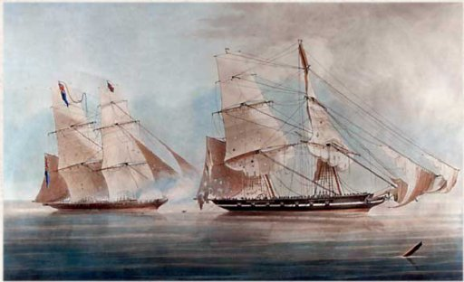

# Приложение: экскурсия по фрегату

Этот раздел описывает общее устройство вымышленного фрегата — корабля Его Величества «Калибан» (HMS *Caliban*), который появляется в сценарии «Чудеса в глубине». Точное устройство и расположение сильно различались даже у кораблей одного размера.

Пользоваться терминами не обязательно, и не стоит волноваться, если забудете название части или направления. За столом просто говорите так, как естественно, — языком, понятным вам и игрокам!

### Направления на корабле

Перёд корабля — «нос» (fore, forward). Зад — «корма» (aft). Правый борт, если смотреть вперёд, — «штирборт» (starboard). Левый — «бакборт» (port или larboard). Наверху, в такелаже, — «наверху» (aloft), внизу — «внизу» (below).

Когда дует ветер, «наветренная» сторона (windward) — та, откуда он дует, «подветренная» (leeward) — та, куда он дует.

### Мачты и такелаж

Первое, что видно у фрегата издали. Центральная, или грот-мачта поднимается примерно на 67 м над палубой. Фок-мачта и бизань-мачта (на корме) ниже. Примерно на трети высоты на мачтах площадки — «марсы», где моряки могут нести вахту или в бою стрелять сверху по неприятелю.

Бушприт — длинное рангоутное дерево (как мачта, но тоньше), выдающееся вперёд за нос корабля. Под бушпритом укрыта резная носовая фигура.

Бесконечное множество разных тросов (штаги, брасы, фалы, ванты, выбленки и т. д.) держат паруса на месте, двигают реи, меняют форму парусов и позволяют лазить к верхним парусам и такелажу.

### Верхняя палуба

Самая верхняя палуба корабля, идущая непрерывно от носа корабля (вперёд, forward) до кормы (aft). На ней обычно стоят пушки поменьше. Штурвал корабля (helm) — на корме этой палубы, там же кабестан — большое устройство, которым выбирают тяжёлые якоря и поднимают другие тяжести.

Гальюн, которым большинство моряков пользуется как уборной, — на носу этой палубы, открытый всем стихиям.

На «Калибане» над верхней палубой на корме поднимаются шканцы. Наветренная сторона шканцев всегда принадлежит только капитану, и когда она там стоит, её нельзя прерывать.

### Орудийная палуба

Орудийная палуба — первая полностью крытая палуба корабля. Здесь большие пушки — по 16 с каждого борта.

Капитанская каюта — на корме этой палубы. У её дверей всегда стоит часовой Королевской морской пехоты.

Камбуз, где готовят еду, — в носовой части, а в самом носу — загон для скота, который живёт там, пока не кончится.

### Жилая палуба

На этой палубе живёт и ест («столуется») большая часть экипажа. На корме — кают-компания, где едят офицеры; спят они в маленьких каютах по обе стороны от кают-компании. Простые матросы едят за столами, подвешенными к нижней стороне палубы над ними, и спят на постелях в гамаках, которые каждый день сворачивают и убирают наверх.

### Орлоп и трюм

Под жилой палубой — неполная палуба, орлоп: обычно там лазарет и кокпит, где живут мичманы. В носовой части — крюйт-камера; у неё тоже стоит часовой морской пехоты, чтобы не было диверсий и несчастных случаев. Под этими неполными палубами — трюм, обычно заполненный бочками, запасными частями и другим грузом.

### Устройство палуб на других кораблях

У больших кораблей, например «двухпалубных» и «трёхпалубных» линейных кораблей с 74 или 100 с лишним пушками, просто добавьте одну или две орудийные палубы, а остальное устройство оставьте в основном таким же.

У меньших кораблей, например шлюпов, уберите орудийную палубу: все пушки — на верхней палубе, и все спят на жилой палубе.
