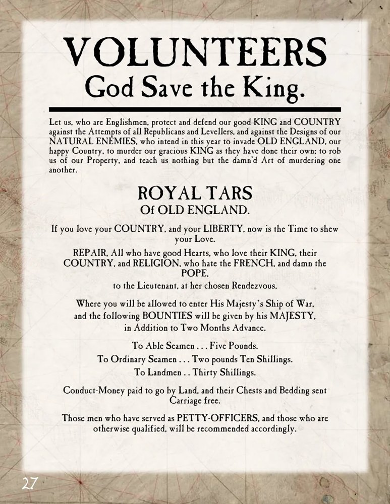

> **Раздатка 1. Вербовочный плакат**
>
> **ДОБРОВОЛЬЦЫ**
>
> **Боже, храни Короля.**
>
> Мы, англичане, защитим и обороним нашего доброго КОРОЛЯ и СТРАНУ от Посягательств всех республиканцев и уравнителей и от Замыслов наших ПРИРОДНЫХ ВРАГОВ, которые в этом году намерены вторгнуться в СТАРУЮ АНГЛИЮ, нашу счастливую Страну, убить нашего милостивого КОРОЛЯ, как убили своего, отнять у нас нашу Собственность и не научить нас ничему, кроме проклятого Искусства убивать друг друга.
>
> **КОРОЛЕВСКИЕ МАТРОСЫ СТАРОЙ АНГЛИИ.**
>
> Если вы любите свою СТРАНУ и свою СВОБОДУ, сейчас самое Время явить вашу Любовь.
>
> ЯВЛЯЙТЕСЬ, все, у кого доброе Сердце, кто любит своего КОРОЛЯ, свою СТРАНУ и ВЕРУ, кто ненавидит ФРАНЦУЗОВ и проклинает ПАПУ, к Лейтенанту, на избранный ею Сборный пункт,
>
> где вам дозволят поступить на Военный корабль Его Величества и где ЕГО ВЕЛИЧЕСТВО выдаст следующие ПРЕМИИ сверх Двухмесячного Жалованья вперёд.
>
> Матросам первой статьи . . . Пять фунтов. 
> Матросам второй статьи . . . Два фунта Десять шиллингов. 
> Сухопутным . . Тридцать шиллингов.
>
> Путевые деньги на дорогу по суше выплачиваются, а Сундуки и Постели доставляются бесплатно.
>
> Тех, кто служил УНТЕР-ОФИЦЕРАМИ, и тех, кто иначе к тому годен, соответственно порекомендуют.
