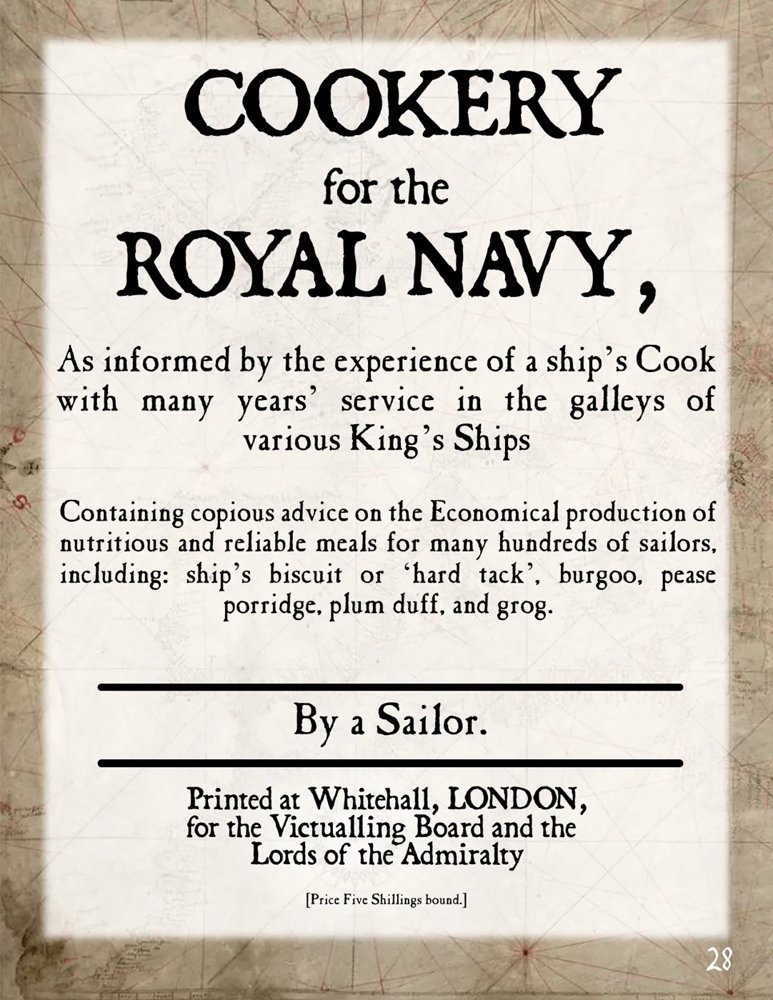

> **Раздатка 2. Кулинария для Королевского флота (титульный лист)**
>
> **КУЛИНАРИЯ** 
> для 
> **КОРОЛЕВСКОГО ФЛОТА,**
>
> по опыту корабельного Кока, много лет прослужившего на камбузах разных Кораблей Короля
>
> Содержит обильные советы по Экономному приготовлению питательной и надёжной пищи для многих сотен моряков, в том числе: корабельного сухаря, или «галеты», бергу, гороховой каши, плам-даффа и грога.
>
> Сочинение Моряка.
>
> Отпечатано в Уайтхолле, ЛОНДОН, для Провиантского совета и Лордов Адмиралтейства
>
> [Цена в переплёте Пять шиллингов.]
