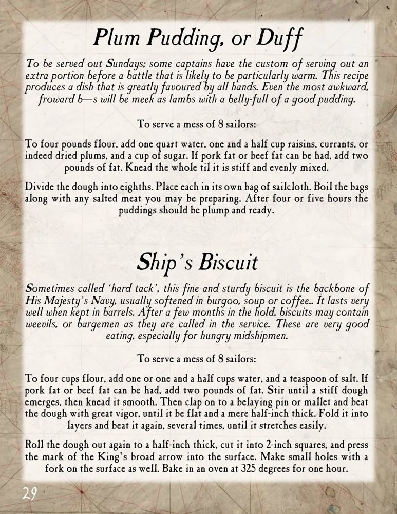

> **Раздатка 2. Кулинария для Королевского флота: сливовый пудинг, или Дафф**
>
> Раздаётся по воскресеньям; у некоторых капитанов в обычае выдавать лишнюю порцию перед боем, который обещает быть особенно жарким. По этому рецепту выходит блюдо, весьма любимое всей командой. Даже самые неуклюжие и строптивые с—и становятся кроткими, как ягнята, с брюхом, полным доброго пудинга.
>
> *На бачок из 8 моряков:*
>
> На 1,8 кг муки — около 1 л воды, полторы чашки изюма, коринки или даже сушёных слив и чашку сахару. Если найдётся свиной или говяжий жир, добавить 0,9 кг жира. Месить всё, пока не станет крутым и однородным.
>
> Разделить тесто на восемь частей. Каждую положить в свой мешочек из парусины. Варить мешочки вместе с солониной, какую вы, может статься, готовите. Через четыре-пять часов пудинги должны стать пухлыми и готовыми.

<!-- -->

> **Раздатка 2. Кулинария для Королевского флота: корабельный сухарь**
>
> Иногда зовётся «галетой»; этот добрый и крепкий сухарь — опора флота Его Величества, обычно его размачивают в бергу, супе или кофе. Он отлично хранится в бочках. Через несколько месяцев в трюме в сухарях могут завестись долгоносики, или «баржевики», как их зовут на службе. Они очень недурны на вкус, особенно для голодных мичманов.
>
> *На бачок из 8 моряков:*
>
> На четыре чашки муки — одна или полторы чашки воды и чайная ложка соли. Если найдётся свиной или говяжий жир, добавить 0,9 кг жира. Мешать, пока не выйдет крутое тесто, затем вымесить его гладко. Потом взять кофель-нагель или киянку и бить тесто со всей силы, пока оно не станет плоским, толщиной всего в 1,3 см. Сложить слоями и снова бить, несколько раз, пока оно не будет легко тянуться.
>
> Снова раскатать тесто толщиной в 1,3 см, нарезать квадратами по 5 см и выдавить на поверхности знак королевской широкой стрелы. Сделать вилкой на поверхности маленькие дырочки. Печь в печи при 325 градусах по Фаренгейту (около 160 °C) один час.

*Прим. перев.: в рецепте сухаря так в оригинале — на четыре чашки муки «два фунта жира», как в пудинге на 4 фунта муки; похоже на ошибочно повторённую строку рецепта.*
