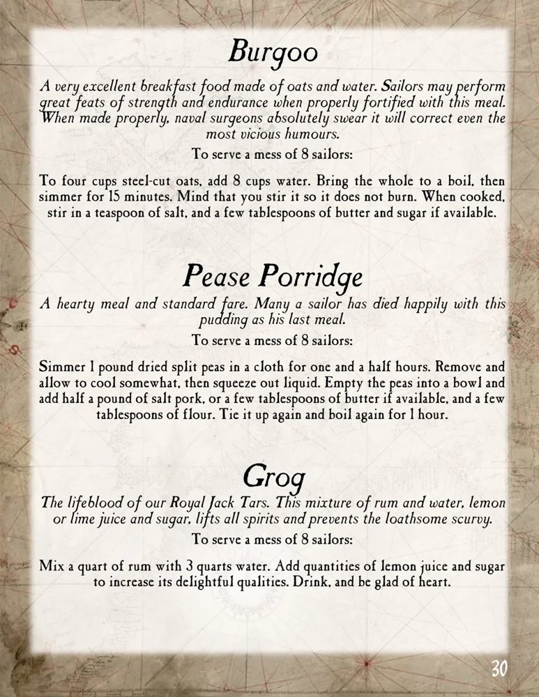

> **Раздатка 2. Кулинария для Королевского флота: бергу**
>
> Превосходная еда на завтрак из овса и воды. Подкрепившись ею как следует, моряки способны на великие подвиги силы и выносливости. Флотские хирурги прямо клянутся, что правильно сваренная, она исправит даже самые скверные гуморы.
>
> *На бачок из 8 моряков:*
>
> На четыре чашки дроблёного овса — 8 чашек воды. Довести до кипения, затем томить 15 минут. Следите, чтобы мешать и не дать пригореть. Когда сварится, вмешать чайную ложку соли и, если есть, несколько столовых ложек масла и сахара.

<!-- -->

> **Раздатка 2. Кулинария для Королевского флота: гороховая каша**
>
> Сытное блюдо и обычная еда. Не один моряк счастливо умер, отведав этот пудинг последним.
>
> *На бачок из 8 моряков:*
>
> Томить 450 г сушёного колотого гороха в тряпице полтора часа. Вынуть, дать немного остыть, затем отжать жидкость. Высыпать горох в миску и добавить 225 г солёной свинины или, если есть, несколько столовых ложек масла и несколько столовых ложек муки. Снова завязать и варить ещё 1 час.

<!-- -->

> **Раздатка 2. Кулинария для Королевского флота: грог**
>
> Кровь жизни наших Королевских матросов. Эта смесь рома и воды, лимонного или лаймового сока и сахара поднимает дух и не даёт развиться мерзкой цинге.
>
> *На бачок из 8 моряков:*
>
> Смешать около 1 л рома с 3 л воды. Добавить лимонного сока и сахара, чтобы усилить его восхитительные свойства. Пейте и веселитесь сердцем.
