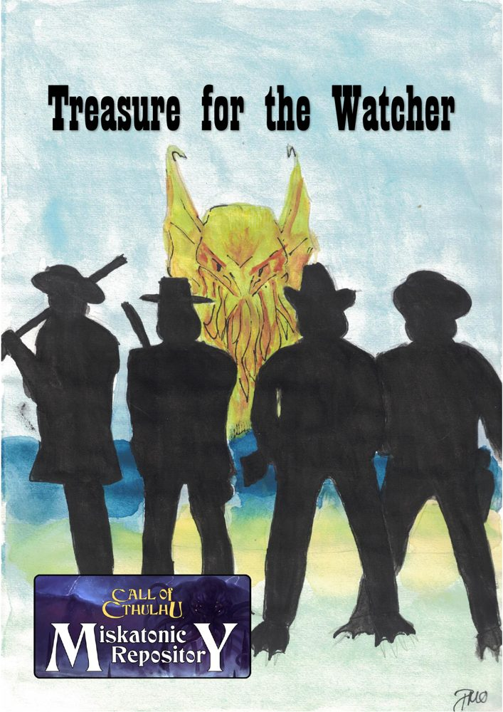

СОКРОВИЩЕ ДЛЯ СТРАЖА

Пол Оуэн

*На обложке — акварель: четыре чёрных силуэта всадников-ковбоев (один с винтовкой на плече) стоят на берегу озера, а над водой поднимается огромная жёлтая голова осьминогоподобного существа — Стража. Вверху — название «Treasure for the Watcher» («Сокровище для Стража»), внизу слева — логотип «Call of Cthulhu — Miskatonic Repository», внизу справа — подпись художника.*
