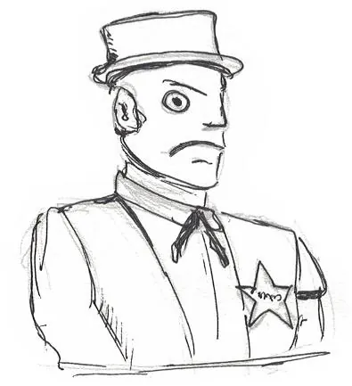

# Вступление

Действие сценария происходит в 1870-х годах в процветающем горнодобывающем районе Среднего Запада; сценарий написан по дополнению Down Darker Trails, но для игры оно не нужно. Прообраз места — Северная Дакота, но действие можно перенести. В своей кампании я взял главным городом Поэтон (Pawheton) из книги Down Darker Trails — им можно заменить Гаррецбург. Сценарий рассчитан на группу из четырёх–шести сыщиков и Хранителя.

Сценарий построен на старых тропах вестерна — ограблении банка и ограблении поезда. Но эта шайка преступников — банда глубоководных и гибридов глубоководных, которые собирают драгоценные металлы, чтобы делать изваяния в дар звёздному отродью Ктулху, живущему в озере.

Сыщикам предстоит остановить банду, которая задумала взорвать мост, когда по нему пойдёт поезд с золотом.

# Предыстория

Около 10 лет назад группа глубоководных и гибридов во главе с братьями Реймондом и Томасом Гилманами переселилась на запад и основала рыбацкий посёлок на озере Девилс-Лейк. Их позвал «Даритель в озере» — Страж, звёздное отродье Ктулху, живущее в глубине озера и ждущее, когда восстанет Великий Ктулху.

Рыбы у посёлка вдоволь, и в честь «Дарителя» поселенцы делают изваяния из драгоценных металлов и бросают их в озеро.

К тому же Гилман — безжалостный делец. Понимая, что людей в Девилс-Лейке не хватает для расширения его дела, он похищает детей из резервации сиу, а детей Лейкфронта забрал после того, как глубоководные перебили там всех остальных.

Посёлок стал доходным, но глубоководным нужно больше металла: они совершили налёт на банк в Гаррецбурге и собираются ограбить поезд с золотом.

# Сыщики

К сценарию прилагаются готовые сыщики; главный герой — окружной маршал. Остальные — его постоянные помощники, и в начале игры они находятся в определённых местах. Это:

*Прим. перев.: здесь в книге список готовых сыщиков не напечатан. Листы шести сыщиков лежат отдельными файлами в папке «Прегены» и переведены в конце этой книги: маршал США Герберт Доул, ковбой Дилан Джеймс, врач Бетти Джулия Боун, юрист Мэриан Харлоу, проповедник Марлон Маккейн и разведчик Чатан.*

Если игроки создают своих сыщиков, одному из них лучше быть представителем закона — маршалом или шерифом. Или это могут быть люди, которых банк нанял вернуть пропавшие серебро и золото.

Сыщики начинают прямо посреди событий: только что ограблен банк «Мидвестерн» в Гаррецбурге.

# Действующие лица

### Гектор Пембертон, управляющий банком, 42 года

Гектора находят связанным в банке «Мидвестерн». Грабители угрозами заставили его открыть сейф. Теперь его место под угрозой, и он будет умолять представителя закона из группы поймать преступников.

- Гектор невысок и лысоват. На нём чёрный жилет поверх белой рубашки и красный галстук, на рукавах — подтяжки.
- Сейчас он сильно потрясён и ведёт себя очень нервно: он знает, что из-за этого ограбления может лишиться места.

### Реймонд Гилман, основатель посёлка и гибрид глубоководного, на вид за 60

Реймонд — мэр Девилс-Лейка и правит посёлком железной рукой. Его брат Томас прежде помогал управлять посёлком, но почти полностью превратился и проводит почти всё время в озере. Реймонд истово служит Стражу, но у него есть и деловые планы на посёлок. Он хочет расширить рыбные промыслы Девилс-Лейка и стать главным поставщиком в округе. Он главный организатор ограбления поезда, и планы лежат у него дома.

- У Реймонда очень большое лицо, торчащее из хорошо сшитого костюма. Шея будто куда-то пропала. У него большие выпученные глаза и широкий, словно безгубый рот.
- Он держится отстранённо, но с чужаками ведёт себя как вежливый джентльмен. Сыщики могут понять, что он непоколебим в своих замыслах насчёт посёлка. Он гордится посёлком и, если спросить, расскажет его историю. Говорит он странно: конец фразы звучит так, будто он говорит под водой.
- Сыщики могут встретить Реймонда у него дома или на улицах посёлка.

### Джон Сэмпсон, шериф Девилс-Лейка и гибрид глубоководного, на вид за 30

Игроки встретят Сэмпсона, если пойдут в тюрьму или будут ходить по посёлку. Сэмпсону будет любопытно, зачем в посёлке ещё один представитель закона, и он станет задавать вопросы. Он замешан в заговоре, но будет изображать невинность. Если сыщики слишком напирают, он может стать для них серьёзной помехой.
