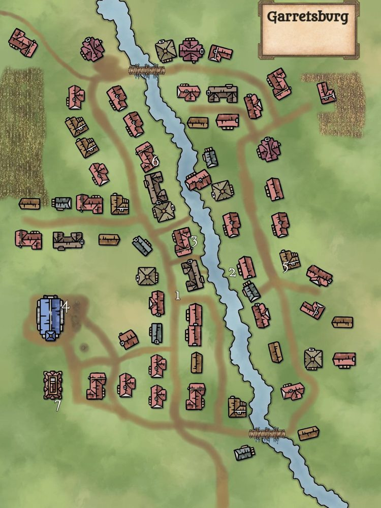

- У Сэмпсона тот же одутловатый облик, что у многих поселенцев: большие глаза и широкий рот. До полного превращения в глубоководного ему ещё далеко, но черты уже видны. Он носит короткую чёрную куртку с шерифской звездой и пояс с револьвером и острым ножом для потрошения рыбы.
- Он вежлив, но непреклонен с сыщиками. Ему не нравится, что в посёлке появился ещё один служитель закона, и он постарается как можно скорее избавиться от сыщиков.
- Если сыщики слишком настойчивы, он пошлёт группу «помощников» их отделать и, возможно, бросит в тюрьму, пока ограбление не закончится.

### Вождь Стоящий Бизон, вождь сиу, 65 лет

Вождь защищает своё племя, гордится им и возмущается любыми обвинениями сыщиков. Он будет отрицать, что сиу как-то причастны к тому, что творится в Лейкфронте, или к пропаже возчиков.

- К сыщикам он выйдет в головном уборе из перьев и ожерелье вождя. Он внушителен и непроницаем.
- Он будет говорить с сыщиками уважительно, но покажет гнев, если они упорствуют в обвинениях. Если они слишком настойчивы, он велит воинам выпроводить их из резервации.

# Гаррецбург

*Надпись на карте: «Garretsburg» — Гаррецбург. Номера 1–7 — важные здания (ниже). Через город с севера на юг течёт река; два моста — на северном и южном краях города.*

Гаррецбург разросся за последние пять лет благодаря золотым и серебряным приискам в соседних холмах. То, что начиналось как палаточный посёлок, стало настоящим городом. Палатки сменились деревянными домами, сюда перебрались фермеры. Некоторые здания описаны ниже.

## Важные здания

**1. Салун «Золотая гора»**

Заведение в целом грубое. Пахнет деревом, виски и опилками. Даг Макадам, здоровенный рыжий ирландец, натирает стойку. Обычно здесь в любое время от 4 до 20 посетителей; вечером и ночью — на несколько больше.

**2. Приёмная врача**

Ухоженное деревянное здание — и врачебная приёмная, и дом врача.

**3. Банк «Мидвестерн» и пробирная контора**

Пробирная контора была одним из первых деревянных зданий в городе. Она недавно выкрашена в ярко-жёлтый цвет, и управляющий содержит её в образцовом порядке. Недавно банк «Мидвестерн» взял на себя финансовые дела города, а заодно и пробу металлов, которые сюда привозят. Над фасадом гордо висит красно-чёрная вывеска с названием. Банком управляет Гектор Пембертон, а охранник — Джексон Феррис, крупный бородач, у которого лучшие годы уже позади.

**4. Баптистская церковь «Маунт-Голд»**

Единственную церковь в городе около 5 лет назад построили на деньги горожан и своими руками. У неё искусно сделанный шпиль.
