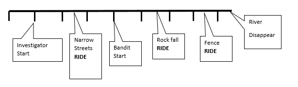

*Схема погони — линия мест слева направо:*

| Место на схеме | Надпись | Перевод |
|---|---|---|
| 2 | Investigator Start | Старт сыщиков |
| 3–4 | Narrow Streets — RIDE | Узкие улочки — проверка Верховой езды |
| 5 | Bandit Start | Старт бандитов |
| 6–7 | Rock fall — RIDE | Обвал — проверка Верховой езды |
| 8–9 | Fence — RIDE | Изгородь — проверка Верховой езды |
| конец | River — Disappear | Река — бандиты исчезают |

**5. Кузница**

Из передней части здания, где работает кузнец, пышет жаром горнов, тянет дымом и запахом плавящегося железа. Живёт он в задней части. Он работает с металлом и подковывает лошадей всего города.

**6. Контора шерифа и тюрьма**

Неприятности в городе обычно случаются по выходным, когда старатели спускаются за припасами. Шерифа обычно можно найти на переднем крыльце конторы — он сидит в кресле-качалке. Здесь же стоит стол окружного маршала. Сейчас у города два помощника шерифа.

**7. Особняк мэра**

Добротный, внушительный особняк. Сад ухожен и цветёт в жару начала лета. Мэр города — Джейн Грейг, строгая дама, которая не терпит глупостей ни от маленького городского совета, ни от любого мужчины.

# Ограбление

В городке Гаррецбург тихое утро. После шумных выходных всё вернулось в обычную колею. Старатели, потратив добычу и пополнив запасы, вернулись на свои участки в горах. Вернулся размеренный ход будней.

Хранитель, в этот момент попросите игроков представить своих сыщиков: кто они, где сейчас находятся в городе и чем заняты. Это поможет понять, насколько они готовы отреагировать на происходящее.

Около 10 утра звуки обычной жизни вдруг разрывают женский крик, выстрел и ржание лошадей. Выстрел прозвучал со стороны банка — сыщики поблизости понимают это сразу, тем, кто дальше, нужна проверка **Слуха** с **бонусной костью**.

У банка события идут в таком порядке; сыщики вступают в сцену по решению Хранителя — в зависимости от того, как они отреагировали на крик.

1. Пятеро бандитов в масках, перекинув седельные сумки через крупы лошадей, вскакивают в сёдла.
2. Они галопом скачут через город на юг, одной рукой держа поводья, в другой — револьверы.
3. Они покидают город через южную равнину, где у реки словно исчезают, бросив лошадей.

*Прим. перев.: на коней вскакивают пятеро бандитов, Пембертон (ниже) говорит о четверых в банке, а в банде шестеро (с. 8, 14) — числа в книге не согласованы.*

## Погоня

Кто-то из сыщиков может оказаться в положении, чтобы пуститься в погоню или встать на пути скачущих бандитов. Схема погони — выше. Из-за внезапности налёта преследователи до первой проверки начинают на три места позади, а не на два. Погоня начинается с проверки **ВЫН** лошадей, дальше — проверки **Верховой езды**. Характеристики лошадей — в конце книги.

Если сыщикам удастся сбить одного из бандитов, они увидят, что он очень уродлив: выпученные глаза, широкий рот. Если взять его живым, он откажется говорить.

## Раненая

У банка, в кольце растущей толпы, лежит Хетти Джаррод. В неё выстрелил один из бандитов, когда она попалась им на пути при выходе. Ей нужна проверка **Первой помощи**.

## Банк «Мидвестерн»

В банке несколько горожан: один хлопочет вокруг расстроенного Гектора Пембертона, другие осматривают Джексона Ферриса — тот сидит, привалившись к стене, пронзённый копьём. Фермер Фред Соломон решительно стоит перед открытой дверью в заднюю контору. Несмотря на налёт, в банке порядок, следов разгрома почти нет.

- Пембертон, успокоившись, объяснит, что ворвались четверо бандитов в масках — шляпы надвинуты, лица закрыты — и метнули копьё в беднягу Ферриса; у того не было ни единого шанса.
- «Они выхватили револьверы и стали мне угрожать. У меня жена и дети. Им нужно было, чтобы я открыл сейф. Я пытался их отговорить, но всё без толку».
- Пембертон открыл сейф, и бандиты совсем не тронули деньги — забрали только золотые и серебряные самородки. Они сложили их в седельные сумки, а один тем временем связал Пембертона и заткнул ему рот.
- Из сейфа выгребли все металлы, но деньги на месте, аккуратно сложены стопками.
