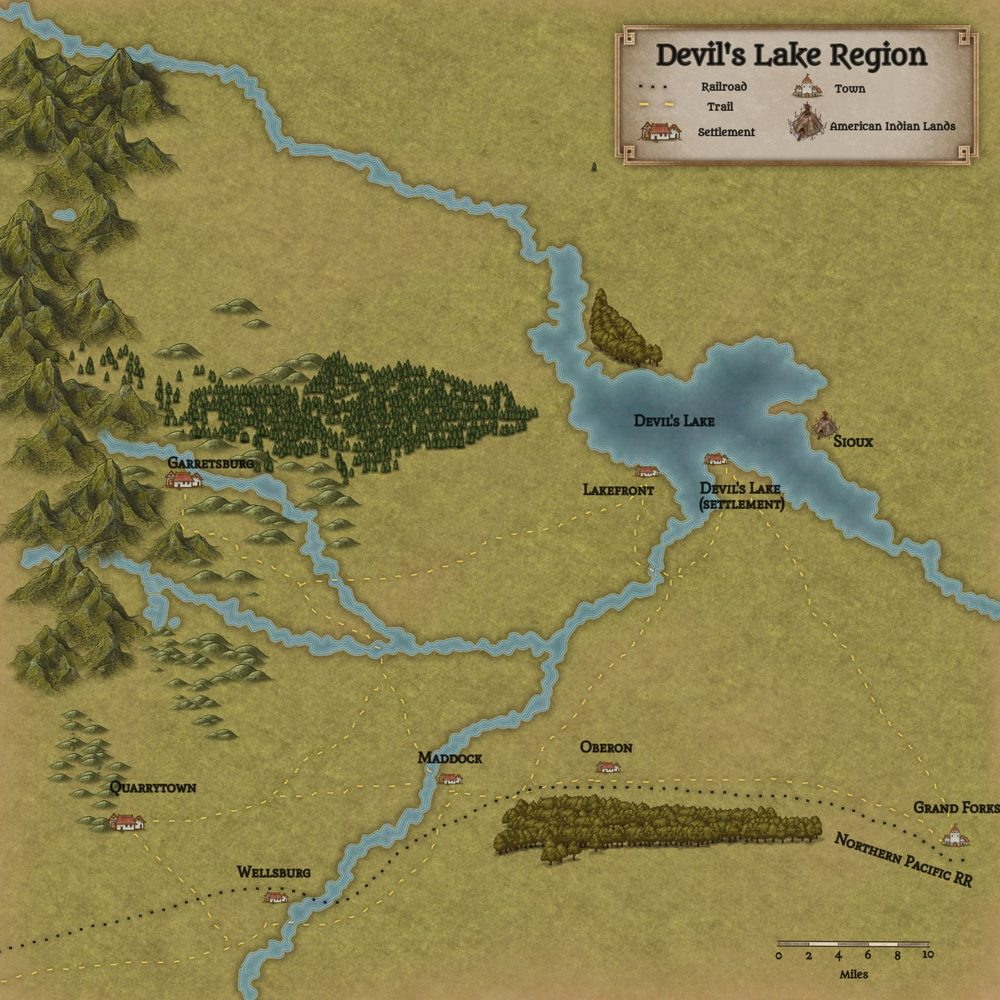

*Надписи на карте: «Devil’s Lake Region» — округа Девилс-Лейк. Условные знаки: Railroad — железная дорога; Trail — тропа; Settlement — поселение; Town — город; American Indian Lands — земли американских индейцев. Масштаб: 0–10 миль (0–16 км).*

| Надпись на карте | Перевод |
|---|---|
| Garretsburg | Гаррецбург |
| Devil’s Lake | озеро Девилс-Лейк |
| Lakefront | Лейкфронт |
| Devil’s Lake (settlement) | Девилс-Лейк (посёлок) |
| Sioux | сиу (резервация сиу) |
| Quarrytown | Кворритаун |
| Wellsburg | Уэллсбург |
| Maddock | Мэддок |
| Oberon | Оберон |
| Grand Forks | Гранд-Форкс |
| Northern Pacific RR | Северная Тихоокеанская железная дорога |

## Мёртвый всадник

Снаружи толпа ахает: сыщики слышат ржание загнанной лошади, а затем глухой удар. На улице навзничь лежит тяжело раненный человек в одежде, покрытой засохшей кровью. Кто-то даёт ему глоток воды. Он хрипит:

«Лейкфронт… набег… племя… всех перебили… ударили топором… сбежал… за мной гнались… пришлите помощь».

Тут человек умирает. Цирюльник Джон Генри замечает: «Это Кевин Льюис, он из Лейкфронта».

Собравшиеся горожане смотрят на представителя закона и спрашивают, что он собирается делать.

# Лейкфронт

Лейкфронт — маленький рыбацкий посёлок, около 40 жителей, примерно в 6 часах езды верхом от Гаррецбурга. Подъезжая, сыщики видят чёрный дым над некоторыми хижинами. Чем ближе, тем виднее разрушения. Несколько хижин сожжено, снасти разломаны, пожитки поселенцев разбросаны по улицам. Ниже — что сыщики могут увидеть в посёлке. Чтобы всё обыскать, нужна пара часов.
