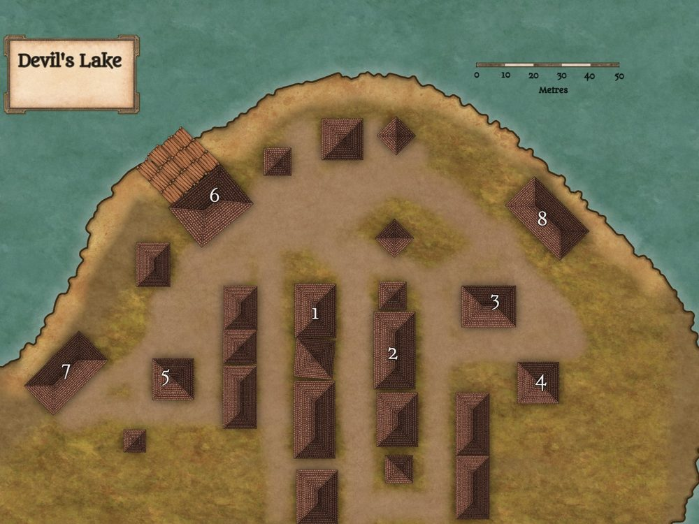

На главной улице сыщики видят салун «Лейк-инн», маленькую лавку, а в конце квартала — контору шерифа и тюрьму. По обе стороны посёлка стоят два больших дома. На западе — кузница, а справа — что-то вроде общинного дома или церкви; рядом — конюшня и извозная контора. Впереди, на берегу, — большое складское здание; носы подсказывают сыщикам, что это рыбоперерабатывающая фабрика.

## История

Историю посёлка можно узнать у священника, у кузнеца или даже у самого Реймонда Гилмана.

- Около 10 лет назад Реймонд и Томас Гилманы привели сюда группу поселенцев из Новой Англии.
- Они были искусными рыбаками и хотели воспользоваться богатым рыбой озером, чтобы расширить семейное дело.
- Посёлок разбогател, продавая свежую и переработанную рыбу и рыбные товары в большие города на юге и по всей стране.

*Надпись на карте: «Devil’s Lake» — Девилс-Лейк. Масштаб: 0–50 метров. Номера 1–8 — важные здания (ниже и на с. 9–10).*

## Важные здания

**1. Контора шерифа и тюрьма**

Шериф посёлка — Джон Сэмпсон. У него тот же «здешний» облик, что и у остальных, и револьвер «Кольт» Нэви .36. Обычно он сидит на крыльце конторы. Сыщиков он встречает с подозрением, особенно других служителей закона. Если спросить о Лейкфронте, он поспешит обвинить сиу. Проверка **Психологии** показывает, что он говорит неправду.

**2. Салун «Лейк-инн»**

В салуне порядок и тишина. Бармен, мистер Фредрик Коул, поднимает глаза, когда входят сыщики. За большим столом в углу сидят шестеро мужчин в длинных пыльниках, вооружённые револьверами. Они тихо переговариваются.

Коул нехотя обслужит сыщиков, но он неразговорчив и на вопросы отвечать не станет. Шестеро мужчин тоже лишь угрожающе посмотрят на сыщиков и в разговор не вступят. Одеты они так же, как бандиты, ограбившие банк. Если сыщики будут им докучать, они встанут и уйдут. У всех — «тот самый облик».

**3. Общинный дом и церковь**

Это здание выкрашено в ярко-белый цвет и содержится в безупречном состоянии. Над дверью — две буквы и треугольник: EOΔ. На северной и южной сторонах — по витражному окну, на восточной — одно большое. Внутри сквозь эти окна льётся свет; витражи изображают подводные сцены: рыб, осьминогов, но также и молящихся, и города. Смотреть на них довольно жутко — проверка **Рассудка** (0/1).

Внутри по обе стороны прохода — несколько скамей, ведущих к алтарю. На алтаре — золотая статуэтка осьминогоподобного существа; похоже, из чистого золота. Перед статуэткой лежит книга в кожаном переплёте, открытая на странице со странными письменами. При успешной проверке **Внимания** сыщик замечает на стене трезубец.

В задней части церкви открывается дверь, и выходит упитанный мужчина средних лет с тем же странным обликом.

«Любуетесь нашим храмом, я вижу», — говорит он.

Это священник Колин Бартон; он может рассказать сыщикам историю посёлка. Если спросить о здешней вере, он ответит: «Даритель озера». Он приветлив до известной степени и ответит на некоторые вопросы, но ничего не выдаст. Вскоре после прихода сыщиков входят шестеро мужчин в длинных пыльниках и широкополых шляпах — будто собрались в дорогу. Если сыщики уже побывали в салуне, это те же шестеро. Священник извинится и попросит сыщиков уйти: у него дела.

Сыщики могут захотеть подслушать, что происходит в церкви. Под церковью есть лаз. Если кто-то решит залезть туда — проверка **Скрытности** (с **бонусной костью**); при провале его замечают, и поселенец идёт за шерифом. Можно также забраться или подсадить кого-то к окну и подслушивать с проверкой **Слуха**.
