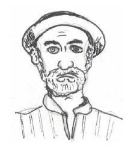
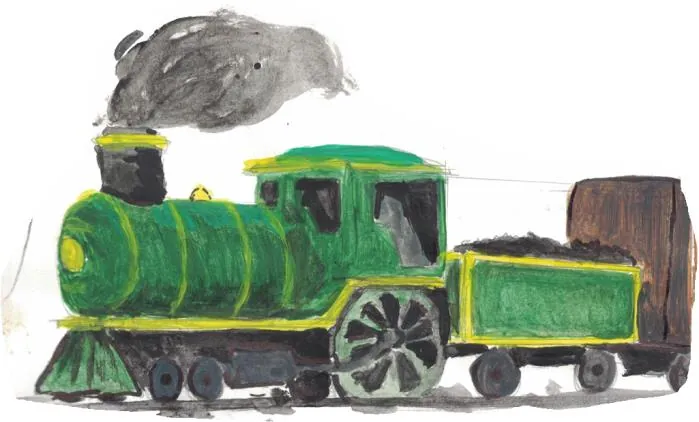

*Прим. перев.: портрет в книге без подписи и стоит у описания кабинета Гилмана; кого он изображает, книга не говорит.*

3. В записной книжке — грубый набросок карты с расположением Кворритауна и Уэллсбурга. Там же отмечено, что через 2 дня через ущелье пройдёт поезд. Есть и записка, адресованная Томасу Гилману: «Мы не можем позволить себе дальше покупать».
4. На стене — карта округи с красной булавкой, воткнутой в реку возле Уэллсбурга. Проверка **Ориентирования** показывает, что это мост в ущелье Уэллсбург.
5. Проверка **Внимания** обнаруживает за картиной сейф. При **трудном** успехе сыщики замечают ключ на верху книжного шкафа, иначе придётся воспользоваться **Взломом**. В сейфе — старый переплетённый фолиант, обтянутый серой острой чешуёй. На обложке выжжено название — «Цивилизации моря» (*Civilizations of the Sea*). См. врезку.

> **Раздатка «Записка Томасу Гилману»**
>
> *«Мы не можем позволить себе дальше покупать».*

**8. Дом Томаса Гилмана**

Добротно построенный дом. Здесь сыщики найдут Маршу Гилман, жену Томаса, и двоих-троих слуг. Томас уже прошёл превращение в глубоководного и редко выходит из пещер под домом. В доме сыщики найдут такие же улики, как в доме Реймонда. Томас оберегает свой дом: если, будучи в подвале, он услышит наверху шум, то поднимется вместе с ещё одним глубоководным, чтобы навести порядок.

## Банда выезжает

После визита в салун шестеро из банды садятся на лошадей и уезжают на юг. Лучше всего, если в этот момент сыщики будут на улице и увидят их. Сыщики могут поехать следом или продолжить расследование. Что бы они ни выбрали, с этого момента время пошло. В первую ночь банда совершит налёт на Кворритаун, а во второй половине следующего дня взорвёт мост, когда по нему пойдёт поезд.

*Вариант Хранителя: в этот момент сыщики видят, как в озере выныривает пловец — похоже, ребёнок. Затем пловец снова скрывается под водой. Один из похищенных детей с рыбоперерабатывающего склада сбежал из пещер, но его ловит один из глубоководных. В пробной игре это разделило группу: маршал решила остаться и расследовать, а остальные поехали за бандой. Маршалу дали комнату в доме Томаса Гилмана, и ночью она отправилась обыскивать посёлок. Когда она вернулась в постель, Томас и ещё один глубоководный пришли, чтобы её схватить, но ей удалось сбежать. Это привело к новому приключению.*

*Если не хотите усложнять игру этим эпизодом, уберите его.*

# Кворритаун

В холмах за деревьями укрыта каменоломня Шрайбера. «Город» — громкое название: на деле это грубый рабочий лагерь, где живут 20–30 рабочих, которые весь день тяжко трудятся у каменной стены карьера. «Город» — это спальные палатки и большая палатка-столовая с козловыми столами и очагом для готовки. В воздухе висит пыль — она осела и на всём остальном. Рабочие лагеря и бригадиры — крепкий народ и глупостей не терпят. **Запугивание** здесь не сработает.

От Девилс-Лейка до брода у Уэллсбурга — примерно 8 часов езды верхом по равнинам и фермерским землям. На переправе сыщики заметят к северу железнодорожный мост через ущелье Уэллсбург. Банда глубоководных свернёт с тропы к северу от Оберона и пересечёт равнину и реку: глубоководные — пловцы получше, им не нужен брод, и они переправят лошадей вплавь. Так они срезают несколько часов пути. Если сыщики едут следом, здесь нужна проверка **Чтения следов**, чтобы понять, что банда ушла с главной дороги. Если сыщики держатся слишком близко, банда заметит их по поднятой пыли. Тогда она может устроить засаду со стрелками и попытаться подстрелить нескольких их лошадей, прежде чем ускакать галопом. Сыщики могут попытаться переправиться через быструю глубокую реку в том же месте, но для этого нужны **трудная** проверка **Плавания** и проверка **Верховой езды**, чтобы успокоить лошадей.

Если сыщикам не удастся остановить банду до Кворритауна, они найдут лагерь в смятении. Рабочие сбились в злые кучки: вооружённые люди, похоже, обходят каждую палатку и раскидывают вещи. Каменотёсы поглядывают на приехавших сыщиков, и к ним подходит крупный мускулистый мужчина.

Он представляется — Вернон Таскер, бригадир — и спрашивает, что сыщики здесь делают. О банде глубоководных он ничего не знает. Проверка **Психологии** показывает, что он говорит правду. Если спросить, что творится в лагере, проверка социального навыка или **Юриспруденции** откроет, что со склада динамита была совершена кража. Пропали провод, детонатор и 24 динамитные шашки, а также охранник Гэри Бейкер.

