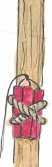
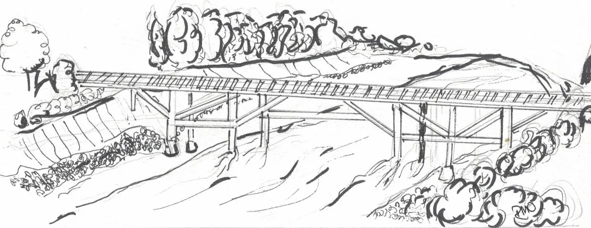

Склад — заколоченная пещера в стене каменоломни. У склада сыщики видят на земле взломанный висячий замок и распахнутую деревянную дверь. Сейчас место сторожит вооружённый охранник. Проверка **Чтения следов** находит разбросанные странные когтистые следы и следы волочения в пыли. Если пойти по ним, они ведут примерно на 70 м в ближайшие заросли — там лежит Гэри Бейкер, его окровавленная рубашка пробита тремя проколами. В зависимости от того, насколько сыщики отстали от банды, совершившей кражу прошлой ночью, Бейкер может быть ещё жив (на усмотрение Хранителя). Если оказать ему **Первую помощь** или **Медицину**, он ненадолго придёт в себя и скажет, что его застали врасплох и откуда-то ударили копьём. Он видел банду: один взломал дверь склада большими вилами, а двое оттащили его в сторону и бросили умирать. Дальнейший осмотр местности и проверка **Чтения следов** находят следы копыт, ведущие на юго-восток.

# Ущелье Уэллсбург

К востоку от процветающего городка Уэллсбург лежит ущелье. Поезд пересекает здесь реку по деревянному эстакадному мосту. Мост высотой около 13 м перекинут через ущелье шириной около 50 м; посередине, между двумя каменистыми отмелями, течёт река шириной около 27 м и глубиной около 7 м.

Банда глубоководных заложила вдоль опор моста шесть зарядов по четыре шашки. Детонатор спрятан в кустах внизу, при нём — один из банды. Когда поезд подойдёт к мосту, банда подорвёт динамит, мост взлетит на воздух, и поезд рухнет в реку. Затем бандиты добьют всех, кто остался жив, и перетащат золото в надёжное место выше по реке, откуда его переправят в Девилс-Лейк. Двое из банды с винтовками прячутся в кустах наверху ущелья, один — у детонатора, а трое ждут внизу, готовые напасть на рухнувший поезд.

Тут нагнетайте напряжение: по равнине к ущелью тянется, приближаясь, столб пара.

В зависимости от действий сыщиков у них может появиться шанс остановить поезд до моста, но если они медлят и бездействуют, шанса не будет. Нужна **трудная** проверка **Внимания**, чтобы заметить двух стрелков в кустах прежде, чем те откроют огонь. Заметив сыщиков, стрелки сделают по ним прицельный выстрел (с **бонусной костью**, если их не заметили и они стреляют первыми). Точно так же нужна ещё одна **трудная** проверка **Внимания**, чтобы проследить провода детонатора до кустов, где он спрятан. Когда начнётся стрельба, глубоководные уйдут в укрытие и будут лишь прикрывать огнём, пока другие члены банды переносят золото. Главное для них — золото, а не убийство сыщиков. Банда глубоководных не станет драться насмерть и попытается сбежать, если перевес не на её стороне. Бандиты бросят свои позиции и уплывут вверх по реке.

Поезд — паровоз, тендер, два товарных вагона, вагон с сейфом и служебный вагон. В поезде трое машинистов: двое впереди и один в служебном вагоне; на площадке вагона с сейфом едут двое вооружённых охранников. Если поезд не сможет остановиться, когда мост взорвут, он рухнет в ущелье, и все, кто в нём, погибнут. Тогда банда вломится в вагон с сейфом, разбитый при падении, и как можно быстрее вынесет все драгоценные металлы.

