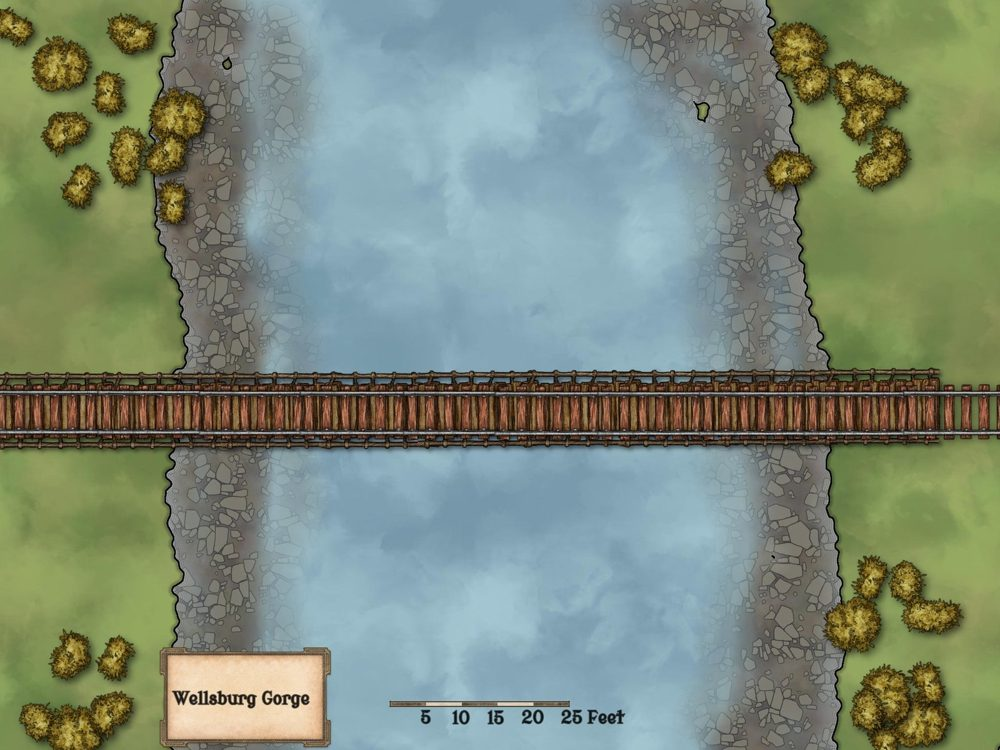

*Надпись на карте: «Wellsburg Gorge» — ущелье Уэллсбург. Масштаб: 5–25 футов (около 2–8 м). Через реку между двумя каменистыми отмелями перекинут деревянный железнодорожный мост; по берегам — трава и кусты.*

# Конец

Перестрелка у ущелья обычно завершает сценарий: сыщикам удаётся или не удаётся помешать ограблению поезда. Но может быть и иначе: сыщики могут пропустить взрыв моста. Тогда им придётся выследить золото до Девилс-Лейка и разобраться с бедой там. Если они справятся, то могут захотеть вернуться и расследовать исчезновение детей или спасти их, если видели беглеца. Здесь я оставляю всё остальное Хранителю и развитию его кампании.

# Награды и потери

- Остановить поезд до крушения: +1d4 Рассудка.
- Остановить банду глубоководных: +1d4 Рассудка.
- Спасти детей: +1d6 Рассудка.
- Не помешать крушению поезда: −1d4 Рассудка.
- Упустить банду: −1d2 Рассудка.

Эти изменения Рассудка — сверх событий, отмеченных в приключении, и сверх потерь при виде глубоководных.

# Приложения

Готовя это приключение, я пользовался книгой Sly Flourish «Return of the Lazy Dungeon Master», особенно главой 6 «Define Secrets and Clues» («Определите секреты и зацепки»). Я записал 10 секретов сценария и привожу их здесь — вдруг пригодятся Хранителю. Использованы были не все.

1. Глубоководные грабят месторождения драгоценных металлов, чтобы делать изваяния Стража в озере.
2. Глубоководные собираются взорвать мост у Уэллсбурга, чтобы пустить под откос поезд с золотом.
3. Реймонд Гилман, гибрид глубоководного, — мозг всей операции.
4. Глубоководные уничтожили рыбацкий посёлок Лейкфронт ради собственного рыбного промысла.
5. Они обставили нападение так, будто это сделали индейцы сиу.
6. Сиу кажутся недоверчивыми к чужакам, но и сами пострадали от нападений глубоководных.
7. Под обоими домами Гилманов — пещеры с выходом к озеру. Золото хранится здесь, пока его не переплавят.
8. Церковь — место собраний Эзотерического ордена Дагона. В ней хранятся книги Мифов.
9. Пропавшие упряжные лошади — в конюшне Девилс-Лейка.
10. У мэра Гранд-Форкса есть окаменевшая жемчужина, которую он нашёл в прерии. Это ключ, чтобы вызвать Стража.

*Прим. перев.: в секрете 10 напечатано «Mayor of Grand Forest» («мэр Гранд-Фореста»), а на карте округи город подписан «Grand Forks» — Гранд-Форкс; по-видимому, это один город.*
