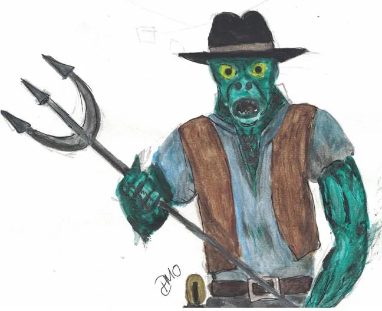

# Персонажи и чудовища

## Реймонд Гилман, гибрид глубоководного

```stat
СИЛ 60    ВЫН 55    ТЕЛ 65    ЛВК 55    ИНТ 80
НАР 20    МОЩ 110   ОБР 85    Рассудок —    ПЗ 12
БкУ: +1d4   Комплекция: 1   СКО: 7   ПМ: 22   Удача: —

Бой
Атак за раунд: 1
Дерринджер .44     60% (30/12), урон 1d10+2
Ближний бой        45% (22/9), урон 1d3+1d4
Уклонение          30% (15/6)

Навыки
Бухгалтерское дело 70%, Мифы Ктулху 60%, Слух 60%, Внимание 50%,
Скрытность 50%, Плавание 80%.

Броня: нет.

Заклинания: Привлечь рыбу, Призыв/укрощение глубоководного,
Связь со звёздным отродьем Ктулху.
```

## Лошадь

```stat
Хар-ка    среднее   броски
СИЛ       140       (3d6+18) × 5
ВЫН       65        (2d6+6) × 5
ТЕЛ       130       (4d6+12) × 5
ЛВК       50        (3d6) × 5
МОЩ       50        (3d6) × 5

Средний бонус к урону (БкУ): +2d6
Средняя комплекция: 3
Средняя скорость (СКО):
  плохая лошадь      СКО 10
  обычная лошадь     СКО 11
  хорошая лошадь     СКО 12
```

*Прим. перев.: пункты здоровья лошади в книге не напечатаны; по правилам (ВЫН + ТЕЛ) / 10 = 19. Перед числами ТЕЛ и ЛВК в книге стоят лишние точки («..130», «..50»).*



## Средний глубоководный

```stat
СИЛ 70    ВЫН 50    ТЕЛ 80    ЛВК 50    ИНТ 65
НАР —     МОЩ 50    ОБР —     Рассудок —    ПЗ 13
БкУ: +1d4   Комплекция: 1   ПМ: 10   Удача: —
СКО: 8 / 10 вплавь

Бой
Атак за раунд: 1 (когти, укус, оружие)
Глубоководные могут нападать когтями и укусом, а также пользоваться
оружием, как люди. Они искусно владеют копьями и трезубцами.

Ближний бой     45% (22/9), урон 1d6+БкУ или оружием
Уклонение       25% (12/5)

Навыки
Лазание 30%, Язык (речь глубоководных) 70%, Язык (глифы Р’льеха) 70%,
Слух 40%, Внимание 40%, Скрытность 40%, Плавание 90%.

Броня: нет.
Потеря Рассудка: 0/1d6 пунктов Рассудка.
```

## Средний гибрид глубоководного

```stat
СИЛ 65    ВЫН 65    ТЕЛ 55    ЛВК 65    ИНТ 65
НАР 35    МОЩ 50    ОБР —     Рассудок —    ПЗ 12
БкУ: 0   Комплекция: 0   ПМ: 10   Удача: —
СКО: 9 / 8 вплавь

Бой
Атак за раунд: 1 (без оружия, оружие)

Ближний бой     45% (22/9), урон 1d3+БкУ или оружием
Уклонение       30% (15/6)

Навыки
Лазание 30%, Язык (речь глубоководных) 70%, Язык (глифы Р’льеха) 70%,
Слух 40%, Внимание 40%, Скрытность 40%, Плавание 90%.

Броня: нет.
Потеря Рассудка: 0/1d4 пунктов Рассудка.
```

*Прим. перев.: в книге Уклонение гибрида напечатано «30%(12/5)» — половина и пятая доля подходят к 25%; здесь доли исправлены по напечатанному проценту — 30% (15/6).*
