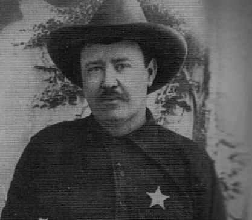
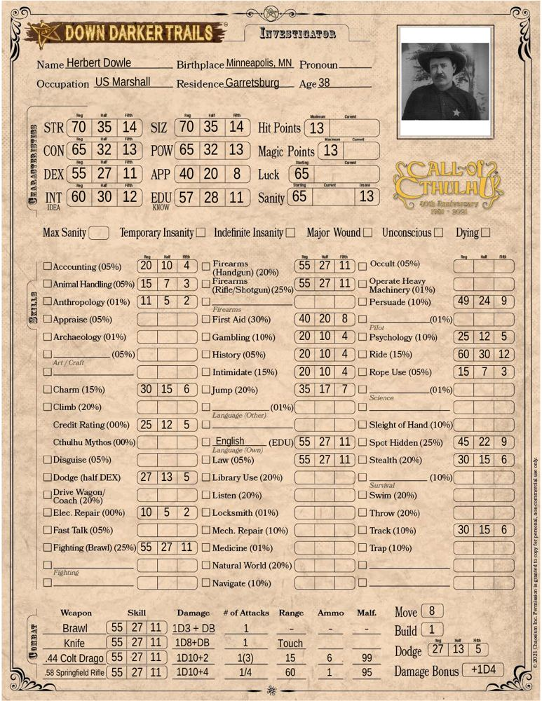

# Готовые сыщики

*Прим. перев.: в разделе «Сыщики» (с. 3) после слов «Это:» список готовых сыщиков не напечатан. Сами сыщики даны отдельными листами в папке «Прегены» рядом с книгой (шесть PDF без текстового слоя, листы сыщика Down Darker Trails, сделаны на dholeshouse.org). Ниже — эти листы: оригинал первой страницы картинкой и все заполненные поля переводом. Главный герой — окружной маршал, остальные — его постоянные помощники.*

## Лист сыщика: маршал США Герберт Доул

*Файл «Прегены\[EN] US Marshall.pdf»: лист сыщика Down Darker Trails (Investigator), с. 1 — данные и бой, с. 2 — предыстория, снаряжение, деньги и сводка правил, с. 3 — пустая страница для заметок.*

| Поле листа | Значение |
|---|---|
| Имя | Герберт Доул (Herbert Dowle) |
| Обращение (Pronoun) | — |
| Профессия | маршал США («US Marshall») |
| Возраст | 38 |
| Место рождения | Миннеаполис, Миннесота («Minneapolis, MN») |
| Место жительства | Гаррецбург («Garretsburg») |

**Характеристики** (значение, половина / пятая доля)

| СИЛ | ВЫН | ТЕЛ | ЛВК | НАР | ИНТ | МОЩ | ОБР |
|---|---|---|---|---|---|---|---|
| 70 (35/14) | 65 (32/13) | 70 (35/14) | 55 (27/11) | 40 (20/8) | 60 (30/12) | 65 (32/13) | 57 (28/11) |

| ПЗ | ПМ | Удача | Рассудок | Безумие (⅕ Рассудка) | СКО | Комплекция | БкУ | Уклонение |
|---|---|---|---|---|---|---|---|---|
| 13 | 13 | 65 | 65 | 13 | 8 | +1 | +1d4 | 27% (13/5) |

*Графы «Макс. Рассудок», «Временное безумие», «Бессрочное безумие», «Серьёзная рана», «Без сознания», «При смерти» и текущие значения — пустые.*

**Навыки** (заполненные на листе; значение, половина / пятая доля)

| Навык | Значение |
|---|---|
| Азартные игры | 20% (10/4) |
| Антропология | 11% (5/2) |
| Ближний бой (драка) | 55% (27/11) |
| Бухгалтерское дело | 20% (10/4) |
| Верховая езда | 60% (30/12) |
| Внимание | 45% (22/9) |
| Запугивание | 20% (10/4) |
| История | 20% (10/4) |
| Обаяние | 30% (15/6) |
| Обращение с верёвкой | 15% (7/3) |
| Обращение с животными | 15% (7/3) |
| Первая помощь | 40% (20/8) |
| Прыжки | 35% (17/7) |
| Психология | 25% (12/5) |
| Родной язык (английский) | 55% (27/11) |
| Скрытность | 30% (15/6) |
| Средства | 25% (12/5) |
| Стрельба (винтовка/дробовик) | 55% (27/11) |
| Стрельба (пистолет) | 55% (27/11) |
| Убеждение | 49% (24/9) |
| Чтение следов | 30% (15/6) |
| Электрика | 10% (5/2) |
| Юриспруденция | 55% (27/11) |
| Уклонение | 27% (13/5) |

**Остальные навыки листа — не заполнены, базовые значения:** Оценка 05%, Археология 01%, Искусство/ремесло 05%, Лазание 20%, Мифы Ктулху 00%, Маскировка 05%, Управление повозкой 20%, Красноречие 05%, Иностранный язык 01%, Работа в библиотеке 20%, Слух 20%, Взлом 01%, Механика 10%, Медицина 01%, Естествознание 20%, Ориентирование 10%, Оккультизм 05%, Управление тяжёлыми машинами 01%, Пилотирование 01%, Наука 01%, Ловкость рук 10%, Выживание 10%, Плавание 20%, Метание 20%, Ловушки 10%. Уклонение — половина ЛВК.

**Оружие**

| Оружие | Обычный | Трудный | Чрезвычайный | Урон | Атак | Дальность | Патронов | Осечка |
|---|---|---|---|---|---|---|---|---|
| Без оружия (драка) (Brawl) | 55 | 27 | 11 | 1d3 + БкУ | 1 | — | — | — |
| Нож (Knife) | 55 | 27 | 11 | 1d8 + БкУ | 1 | касание | — | — |
| Револьвер «Кольт» Драгун .44 (.44 Colt Drago[on]) | 55 | 27 | 11 | 1d10+2 | 1 (3) | 15 м | 6 | 99 |
| Винтовка «Спрингфилд» .58 (.58 Springfield Rifle) | 55 | 27 | 11 | 1d10+4 | 1/4 | 60 м | 1 | 95 |

**Бой:** СКО 8, комплекция +1, уклонение 27% (13/5), бонус к урону +1d4.

**Предыстория** (с. 2 листа; графа «Моя история» пустая)

| Графа | Запись |
|---|---|
| Личное описание (Personal Description) | Крупный мужчина, чьи мышцы понемногу заплывают жиром; на лице шрам от боя Гражданской войны. |
| Идеология и убеждения (Ideology & Beliefs) | Закон един для всех. |
| Значимые люди (Significant People) | Женат на Марии, женщине мексиканского происхождения, и предан ей. |
| Значимые места (Meaningful Locations) | — |
| Ценные вещи (Treasured Possessions) | Значок маршала — то, чем он больше всего гордится. |
| Черты (Traits) | Не теряет Рассудка при виде трупа или тяжёлой раны. |
| Травмы и шрамы (Injuries & Scars) | Шрам на лице с Гражданской войны. |
| Фобии и мании (Phobias & Manias) | — |
| Тайные книги и заклинания (Arcane Tomes & Spells) | — |
| Встречи со странными сущностями (Encounters with Strange Entities) | — |

**Снаряжение и имущество (Gear & Possessions):** не заполнено.

**Деньги (Wealth):** уровень расходов — 5 долларов; наличные — 25 долларов; имущество — 625 долларов.

*Графы «Другие сыщики» (Fellow Investigators: персонаж — игрок) пустые.*

*Прим. перев.: название револьвера на листе обрезано — «.44 Colt Drago»; это «Кольт Драгун» (.44 Colt Dragoon).*

**Сводка правил на листе (Quick Reference Rules):**

| Уровень успеха | Провал | Неудача | Обычный | Трудный | Чрезвычайный | Критический |
|---|---|---|---|---|---|---|
| Бросок | 100 / 96+ | > навыка | ≤ навыка | ≤ ½ навыка | ≤ ⅕ навыка | 01 |

- Проверку можно повторить (Pushing Rolls), только обосновав это; нельзя повторять проверки боя и Рассудка.
- Ранения и лечение: Первая помощь восстанавливает 1 ПЗ, Медицина — 1d3 ПЗ. Серьёзная рана — потеря не меньше половины максимума ПЗ за одну атаку. 0 ПЗ без серьёзной раны — без сознания; 0 ПЗ с серьёзной раной — при смерти. При смерти: Первая помощь временно стабилизирует, затем нужна Медицина. Естественное восстановление без серьёзной раны — 1 ПЗ в день; с серьёзной раной — еженедельная проверка восстановления.

*Внизу листа: «© 2021 Chaosium Inc. Разрешается копировать для личного некоммерческого использования»; эмблема «Call of Cthulhu — 40th Anniversary 1981–2021».*
