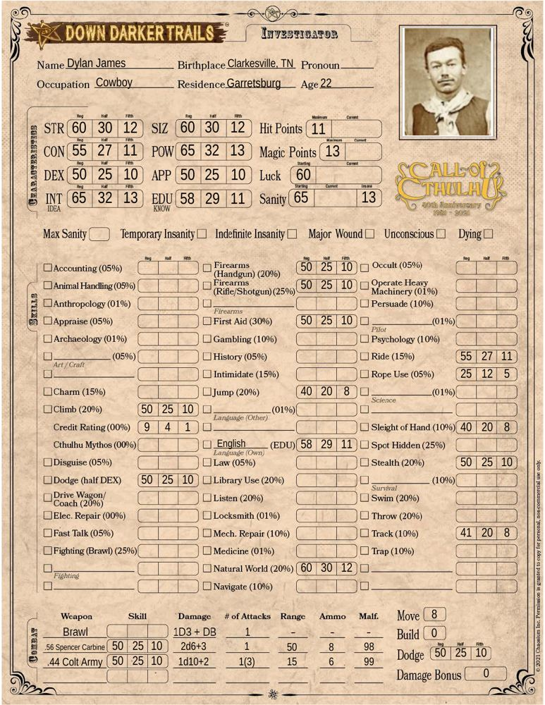

## Лист сыщика: ковбой Дилан Джеймс

*Файл «Прегены\[EN] Cowboy.pdf»: лист сыщика Down Darker Trails (Investigator), с. 1 — данные и бой, с. 2 — предыстория, снаряжение, деньги и сводка правил, с. 3 — пустая страница для заметок.*

| Поле листа | Значение |
|---|---|
| Имя | Дилан Джеймс (Dylan James) |
| Обращение (Pronoun) | — |
| Профессия | ковбой («Cowboy») |
| Возраст | 22 |
| Место рождения | Кларксвилл, Теннесси («Clarkesville, TN») |
| Место жительства | Гаррецбург («Garretsburg») |

**Характеристики** (значение, половина / пятая доля)

| СИЛ | ВЫН | ТЕЛ | ЛВК | НАР | ИНТ | МОЩ | ОБР |
|---|---|---|---|---|---|---|---|
| 60 (30/12) | 55 (27/11) | 60 (30/12) | 50 (25/10) | 50 (25/10) | 65 (32/13) | 65 (32/13) | 58 (29/11) |

| ПЗ | ПМ | Удача | Рассудок | Безумие (⅕ Рассудка) | СКО | Комплекция | БкУ | Уклонение |
|---|---|---|---|---|---|---|---|---|
| 11 | 13 | 60 | 65 | 13 | 8 | 0 | 0 | 50% (25/10) |

*Графы «Макс. Рассудок», «Временное безумие», «Бессрочное безумие», «Серьёзная рана», «Без сознания», «При смерти» и текущие значения — пустые.*

**Навыки** (заполненные на листе; значение, половина / пятая доля)

| Навык | Значение |
|---|---|
| Верховая езда | 55% (27/11) |
| Естествознание | 60% (30/12) |
| Лазание | 50% (25/10) |
| Ловкость рук | 40% (20/8) |
| Обращение с верёвкой | 25% (12/5) |
| Первая помощь | 50% (25/10) |
| Прыжки | 40% (20/8) |
| Родной язык (английский) | 58% (29/11) |
| Скрытность | 50% (25/10) |
| Средства | 9% (4/1) |
| Стрельба (винтовка/дробовик) | 50% (25/10) |
| Стрельба (пистолет) | 50% (25/10) |
| Чтение следов | 41% (20/8) |
| Уклонение | 50% (25/10) |

**Остальные навыки листа — не заполнены, базовые значения:** Бухгалтерское дело 05%, Обращение с животными 05%, Антропология 01%, Оценка 05%, Археология 01%, Искусство/ремесло 05%, Обаяние 15%, Мифы Ктулху 00%, Маскировка 05%, Управление повозкой 20%, Электрика 00%, Красноречие 05%, Ближний бой (драка) 25%, Азартные игры 10%, История 05%, Запугивание 15%, Иностранный язык 01%, Юриспруденция 05%, Работа в библиотеке 20%, Слух 20%, Взлом 01%, Механика 10%, Медицина 01%, Ориентирование 10%, Оккультизм 05%, Управление тяжёлыми машинами 01%, Убеждение 10%, Пилотирование 01%, Психология 10%, Наука 01%, Внимание 25%, Выживание 10%, Плавание 20%, Метание 20%, Ловушки 10%. Уклонение — половина ЛВК.

**Оружие**

| Оружие | Обычный | Трудный | Чрезвычайный | Урон | Атак | Дальность | Патронов | Осечка |
|---|---|---|---|---|---|---|---|---|
| Без оружия (драка) (Brawl) | — | — | — | 1d3 + БкУ | 1 | — | — | — |
| Карабин «Спенсер» .56 (.56 Spencer Carbine) | 50 | 25 | 10 | 2d6+3 | 1 | 50 м | 8 | 98 |
| Револьвер «Кольт» Арми .44 (.44 Colt Army) | 50 | 25 | 10 | 1d10+2 | 1 (3) | 15 м | 6 | 99 |

**Бой:** СКО 8, комплекция 0, уклонение 50% (25/10), бонус к урону 0.

**Предыстория** (с. 2 листа; графа «Моя история» пустая)

| Графа | Запись |
|---|---|
| Личное описание (Personal Description) | Среднего роста, загорелая кожа, грубые руки. |
| Идеология и убеждения (Ideology & Beliefs) | Тяжёлый трудовой день проще, чем раздумья. |
| Значимые люди (Significant People) | — |
| Значимые места (Meaningful Locations) | — |
| Ценные вещи (Treasured Possessions) | Кнут. |
| Черты (Traits) | Говорит тихо, по молодости застенчив. |
| Травмы и шрамы (Injuries & Scars) | — |
| Фобии и мании (Phobias & Manias) | — |
| Тайные книги и заклинания (Arcane Tomes & Spells) | — |
| Встречи со странными сущностями (Encounters with Strange Entities) | — |

**Снаряжение и имущество (Gear & Possessions):** Верёвка.

**Деньги (Wealth):** не заполнено.

*Графы «Другие сыщики» (Fellow Investigators: персонаж — игрок) пустые.*

*Прим. перев.: в строке «Brawl» графа навыка пуста, графа «Fighting (Brawl)» не заполнена — используйте базовый навык Ближний бой (драка) 25% (12/5).*

*Прим. перев.: Уклонение 50% (25/10) выше базовой половины ЛВК — так на листе (видимо, вложены очки навыков).*

*Сводка правил и выходные данные на с. 2 листа — те же, что у маршала (см. первый лист).*
