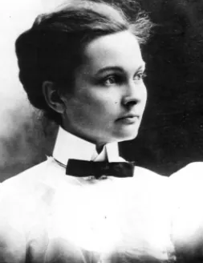
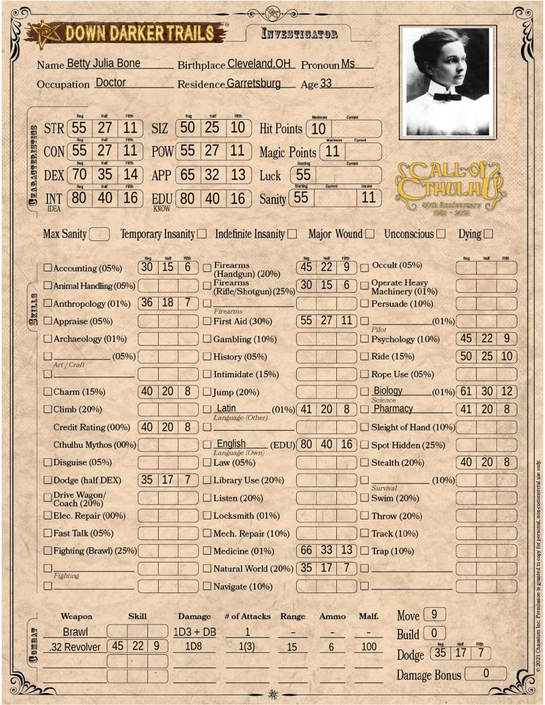

## Лист сыщика: врач Бетти Джулия Боун

*Файл «Прегены\[EN] Doctor.pdf»: лист сыщика Down Darker Trails (Investigator), с. 1 — данные и бой, с. 2 — предыстория, снаряжение, деньги и сводка правил, с. 3 — пустая страница для заметок.*

| Поле листа | Значение |
|---|---|
| Имя | Бетти Джулия Боун (Betty Julia Bone) |
| Обращение (Pronoun) | Ms (мисс) |
| Профессия | врач («Doctor») |
| Возраст | 33 |
| Место рождения | Кливленд, Огайо («Cleveland, OH») |
| Место жительства | Гаррецбург («Garretsburg») |

**Характеристики** (значение, половина / пятая доля)

| СИЛ | ВЫН | ТЕЛ | ЛВК | НАР | ИНТ | МОЩ | ОБР |
|---|---|---|---|---|---|---|---|
| 55 (27/11) | 55 (27/11) | 50 (25/10) | 70 (35/14) | 65 (32/13) | 80 (40/16) | 55 (27/11) | 80 (40/16) |

| ПЗ | ПМ | Удача | Рассудок | Безумие (⅕ Рассудка) | СКО | Комплекция | БкУ | Уклонение |
|---|---|---|---|---|---|---|---|---|
| 10 | 11 | 55 | 55 | 11 | 9 | 0 | 0 | 35% (17/7) |

*Графы «Макс. Рассудок», «Временное безумие», «Бессрочное безумие», «Серьёзная рана», «Без сознания», «При смерти» и текущие значения — пустые.*

**Навыки** (заполненные на листе; значение, половина / пятая доля)

| Навык | Значение |
|---|---|
| Антропология | 36% (18/7) |
| Бухгалтерское дело | 30% (15/6) |
| Верховая езда | 50% (25/10) |
| Естествознание | 35% (17/7) |
| Иностранный язык (латынь) | 41% (20/8) |
| Медицина | 66% (33/13) |
| Наука (биология) | 61% (30/12) |
| Наука (фармацевтика) | 41% (20/8) |
| Обаяние | 40% (20/8) |
| Первая помощь | 55% (27/11) |
| Психология | 45% (22/9) |
| Родной язык (английский) | 80% (40/16) |
| Скрытность | 40% (20/8) |
| Средства | 40% (20/8) |
| Стрельба (винтовка/дробовик) | 30% (15/6) |
| Стрельба (пистолет) | 45% (22/9) |
| Уклонение | 35% (17/7) |

**Остальные навыки листа — не заполнены, базовые значения:** Обращение с животными 05%, Оценка 05%, Археология 01%, Искусство/ремесло 05%, Лазание 20%, Мифы Ктулху 00%, Маскировка 05%, Управление повозкой 20%, Электрика 00%, Красноречие 05%, Ближний бой (драка) 25%, Азартные игры 10%, История 05%, Запугивание 15%, Прыжки 20%, Юриспруденция 05%, Работа в библиотеке 20%, Слух 20%, Взлом 01%, Механика 10%, Ориентирование 10%, Оккультизм 05%, Управление тяжёлыми машинами 01%, Убеждение 10%, Пилотирование 01%, Обращение с верёвкой 05%, Ловкость рук 10%, Внимание 25%, Выживание 10%, Плавание 20%, Метание 20%, Чтение следов 10%, Ловушки 10%. Уклонение — половина ЛВК.

**Оружие**

| Оружие | Обычный | Трудный | Чрезвычайный | Урон | Атак | Дальность | Патронов | Осечка |
|---|---|---|---|---|---|---|---|---|
| Без оружия (драка) (Brawl) | — | — | — | 1d3 + БкУ | 1 | — | — | — |
| Револьвер .32 (.32 Revolver) | 45 | 22 | 9 | 1d8 | 1 (3) | 15 м | 6 | 100 |

**Бой:** СКО 9, комплекция 0, уклонение 35% (17/7), бонус к урону 0.

**Предыстория** (с. 2 листа; графа «Моя история» пустая)

| Графа | Запись |
|---|---|
| Личное описание (Personal Description) | Бледная кожа, тёмные волосы. |
| Идеология и убеждения (Ideology & Beliefs) | Медицинская помощь — для всех. |
| Значимые люди (Significant People) | — |
| Значимые места (Meaningful Locations) | — |
| Ценные вещи (Treasured Possessions) | Стетоскоп отца. |
| Черты (Traits) | Стойкая перед лицом невзгод. |
| Травмы и шрамы (Injuries & Scars) | — |
| Фобии и мании (Phobias & Manias) | — |
| Тайные книги и заклинания (Arcane Tomes & Spells) | — |
| Встречи со странными сущностями (Encounters with Strange Entities) | — |

**Снаряжение и имущество (Gear & Possessions):** Врачебный саквояж.

**Деньги (Wealth):** уровень расходов — 10 долларов; наличные — 80 долларов; имущество — 2 000 долларов.

*Графы «Другие сыщики» (Fellow Investigators: персонаж — игрок) пустые.*

*Прим. перев.: в строке «Brawl» графа навыка пуста, графа «Fighting (Brawl)» не заполнена — используйте базовый навык Ближний бой (драка) 25% (12/5).*

*Сводка правил и выходные данные на с. 2 листа — те же, что у маршала (см. первый лист).*
