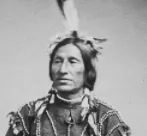
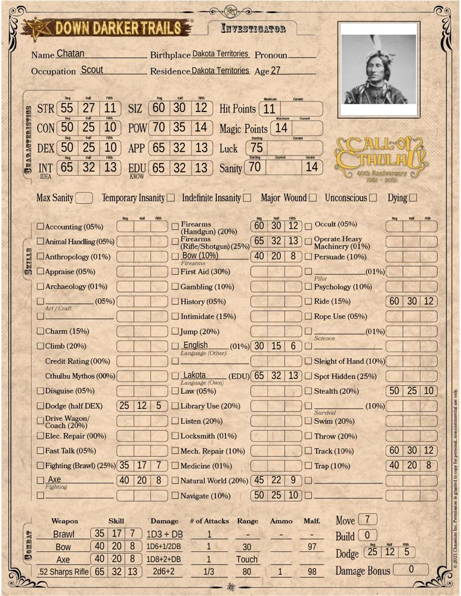

## Лист сыщика: разведчик Чатан

*Файл «Прегены\[EN] Scout.pdf»: лист сыщика Down Darker Trails (Investigator), с. 1 — данные и бой, с. 2 — предыстория, снаряжение, деньги и сводка правил, с. 3 — пустая страница для заметок.*

| Поле листа | Значение |
|---|---|
| Имя | Чатан (Chatan) |
| Обращение (Pronoun) | — |
| Профессия | разведчик («Scout») |
| Возраст | 27 |
| Место рождения | Территория Дакота («Dakota Territories») |
| Место жительства | Территория Дакота («Dakota Territories») |

**Характеристики** (значение, половина / пятая доля)

| СИЛ | ВЫН | ТЕЛ | ЛВК | НАР | ИНТ | МОЩ | ОБР |
|---|---|---|---|---|---|---|---|
| 55 (27/11) | 50 (25/10) | 60 (30/12) | 50 (25/10) | 65 (32/13) | 65 (32/13) | 70 (35/14) | 65 (32/13) |

| ПЗ | ПМ | Удача | Рассудок | Безумие (⅕ Рассудка) | СКО | Комплекция | БкУ | Уклонение |
|---|---|---|---|---|---|---|---|---|
| 11 | 14 | 75 | 70 | 14 | 7 | 0 | 0 | 25% (12/5) |

*Графы «Макс. Рассудок», «Временное безумие», «Бессрочное безумие», «Серьёзная рана», «Без сознания», «При смерти» и текущие значения — пустые.*

**Навыки** (заполненные на листе; значение, половина / пятая доля)

| Навык | Значение |
|---|---|
| Ближний бой (драка) | 35% (17/7) |
| Ближний бой (топор) | 40% (20/8) |
| Верховая езда | 60% (30/12) |
| Естествознание | 45% (22/9) |
| Иностранный язык (английский) | 30% (15/6) |
| Ловушки | 40% (20/8) |
| Ориентирование | 50% (25/10) |
| Родной язык (лакота) | 65% (32/13) |
| Скрытность | 50% (25/10) |
| Стрельба (винтовка/дробовик) | 65% (32/13) |
| Стрельба (лук) | 40% (20/8) |
| Стрельба (пистолет) | 60% (30/12) |
| Чтение следов | 60% (30/12) |
| Уклонение | 25% (12/5) |

**Остальные навыки листа — не заполнены, базовые значения:** Бухгалтерское дело 05%, Обращение с животными 05%, Антропология 01%, Оценка 05%, Археология 01%, Искусство/ремесло 05%, Обаяние 15%, Лазание 20%, Средства 00%, Мифы Ктулху 00%, Маскировка 05%, Управление повозкой 20%, Электрика 00%, Красноречие 05%, Первая помощь 30%, Азартные игры 10%, История 05%, Запугивание 15%, Прыжки 20%, Юриспруденция 05%, Работа в библиотеке 20%, Слух 20%, Взлом 01%, Механика 10%, Медицина 01%, Оккультизм 05%, Управление тяжёлыми машинами 01%, Убеждение 10%, Пилотирование 01%, Психология 10%, Обращение с верёвкой 05%, Наука 01%, Ловкость рук 10%, Внимание 25%, Выживание 10%, Плавание 20%, Метание 20%. Уклонение — половина ЛВК.

**Оружие**

| Оружие | Обычный | Трудный | Чрезвычайный | Урон | Атак | Дальность | Патронов | Осечка |
|---|---|---|---|---|---|---|---|---|
| Без оружия (драка) (Brawl) | 35 | 17 | 7 | 1d3 + БкУ | 1 | — | — | — |
| Лук (Bow) | 40 | 20 | 8 | 1d6 + ½ БкУ | 1 | 30 м | — | 97 |
| Топор (Axe) | 40 | 20 | 8 | 1d8+2 + БкУ | 1 | касание | — | — |
| Винтовка «Шарпс» .52 (.52 Sharps Rifle) | 65 | 32 | 13 | 2d6+2 | 1/3 | 80 м | 1 | 98 |

**Бой:** СКО 7, комплекция 0, уклонение 25% (12/5), бонус к урону 0.

**Предыстория** (с. 2 листа; графа «Моя история» пустая)

| Графа | Запись |
|---|---|
| Личное описание (Personal Description) | Невысокий и жилистый, американский индеец. |
| Идеология и убеждения (Ideology & Beliefs) | Земля прокормит. |
| Значимые люди (Significant People) | — |
| Значимые места (Meaningful Locations) | — |
| Ценные вещи (Treasured Possessions) | Головной убор из ястребиных перьев. |
| Черты (Traits) | Тих и решителен. |
| Травмы и шрамы (Injuries & Scars) | — |
| Фобии и мании (Phobias & Manias) | — |
| Тайные книги и заклинания (Arcane Tomes & Spells) | — |
| Встречи со странными сущностями (Encounters with Strange Entities) | — |

**Снаряжение и имущество (Gear & Possessions):** не заполнено.

**Деньги (Wealth):** не заполнено.

*Графы «Другие сыщики» (Fellow Investigators: персонаж — игрок) пустые.*

*Сводка правил и выходные данные на с. 2 листа — те же, что у маршала (см. первый лист).*
