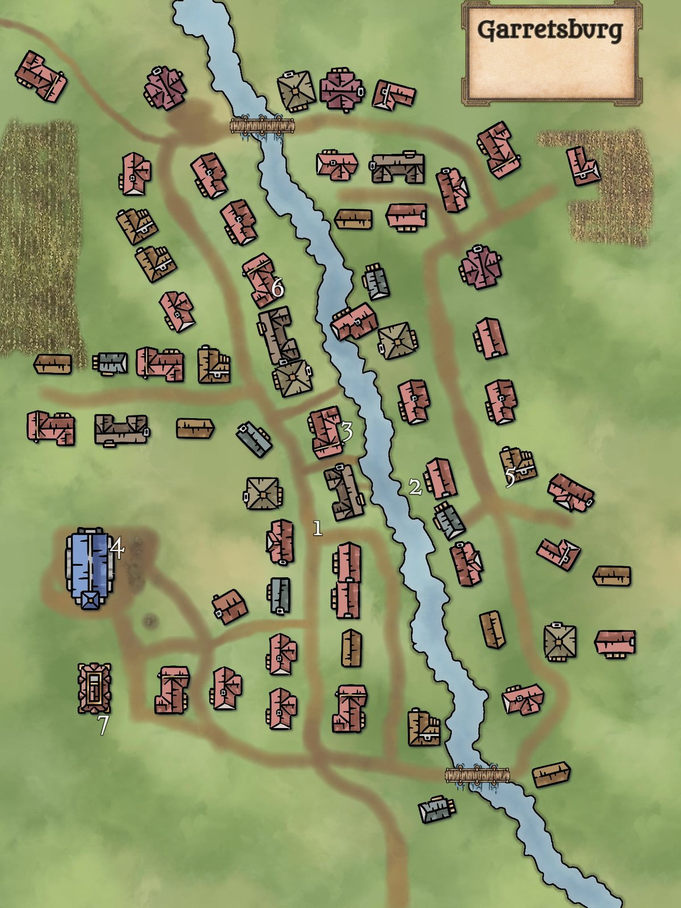

# Карты

*Четыре карты из папки «Maps» рядом с книгой (JPG большего размера; те же карты напечатаны в книге). Подписи — переводом.*

## Карта: Гаррецбург

*Надпись на карте: «Garretsburg» — Гаррецбург. Масштаба нет. Через город с севера на юг течёт река; два моста — на северном и южном краях.*

**Ключ**

| № | Место |
|---|---|
| 1 | Салун «Золотая гора» |
| 2 | Приёмная врача |
| 3 | Банк «Мидвестерн» и пробирная контора |
| 4 | Баптистская церковь «Маунт-Голд» |
| 5 | Кузница |
| 6 | Контора шерифа и тюрьма |
| 7 | Особняк мэра |

*В книге эта карта — на с. 4.*
