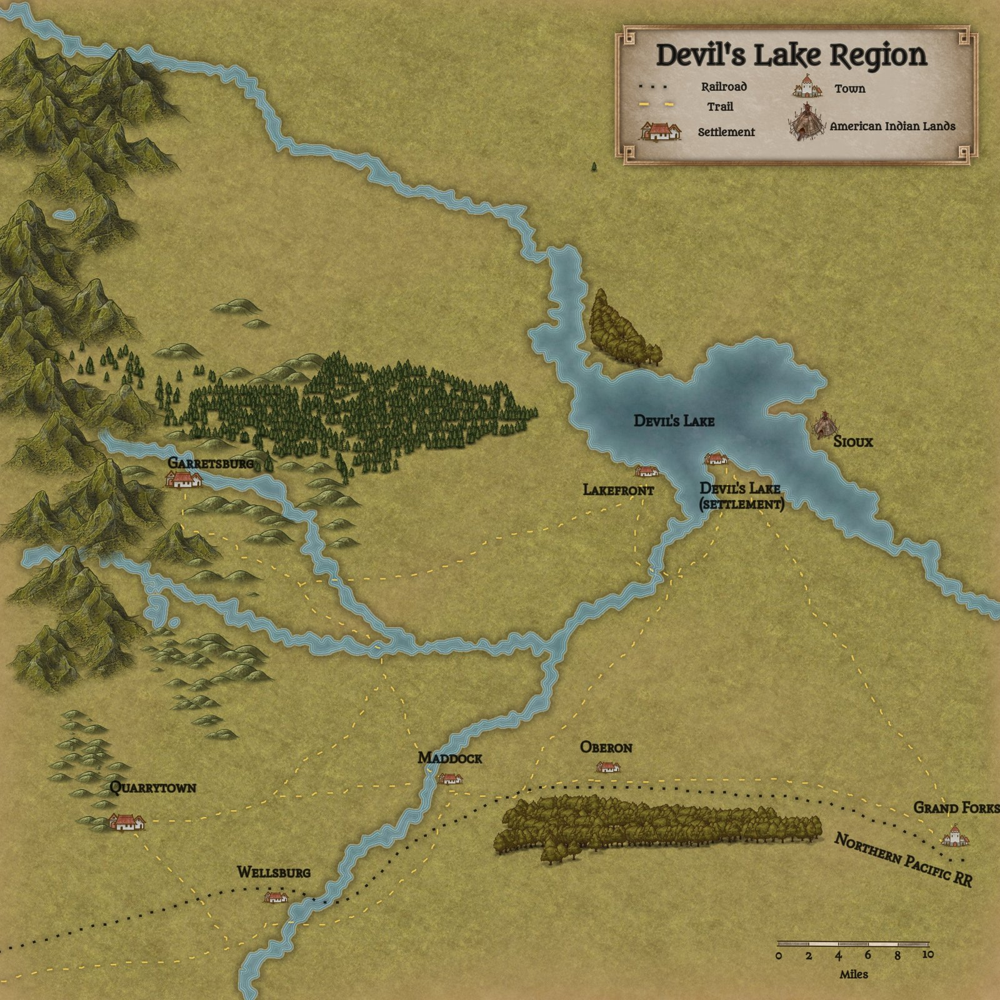

## Карта: округа Девилс-Лейк

*Надпись на карте: «Devil’s Lake Region» — округа Девилс-Лейк. Условные знаки: Railroad — железная дорога; Trail — тропа; Settlement — поселение; Town — город; American Indian Lands — земли американских индейцев. Масштаб: 0–10 миль (0–16 км).*

**Подписи**

| Надпись на карте | Перевод |
|---|---|
| Garretsburg | Гаррецбург |
| Devil’s Lake | озеро Девилс-Лейк |
| Lakefront | Лейкфронт |
| Devil’s Lake (settlement) | Девилс-Лейк (посёлок) |
| Sioux | сиу (резервация сиу) |
| Quarrytown | Кворритаун |
| Wellsburg | Уэллсбург |
| Maddock | Мэддок |
| Oberon | Оберон |
| Grand Forks | Гранд-Форкс |
| Northern Pacific RR | Северная Тихоокеанская железная дорога |

*В книге эта карта — на с. 6.*
