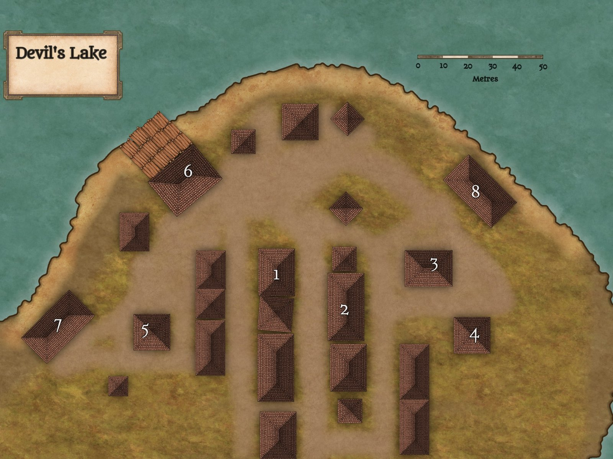

## Карта: Девилс-Лейк

*Надпись на карте: «Devil’s Lake» — Девилс-Лейк. Масштаб: 0–50 метров.*

**Ключ**

| № | Место |
|---|---|
| 1 | Контора шерифа и тюрьма |
| 2 | Салун «Лейк-инн» |
| 3 | Общинный дом и церковь |
| 4 | Конюшня и извоз |
| 5 | Кузница |
| 6 | Рыбоперерабатывающий склад |
| 7 | Дом Реймонда Гилмана |
| 8 | Дом Томаса Гилмана |

*В книге эта карта — на с. 8.*
