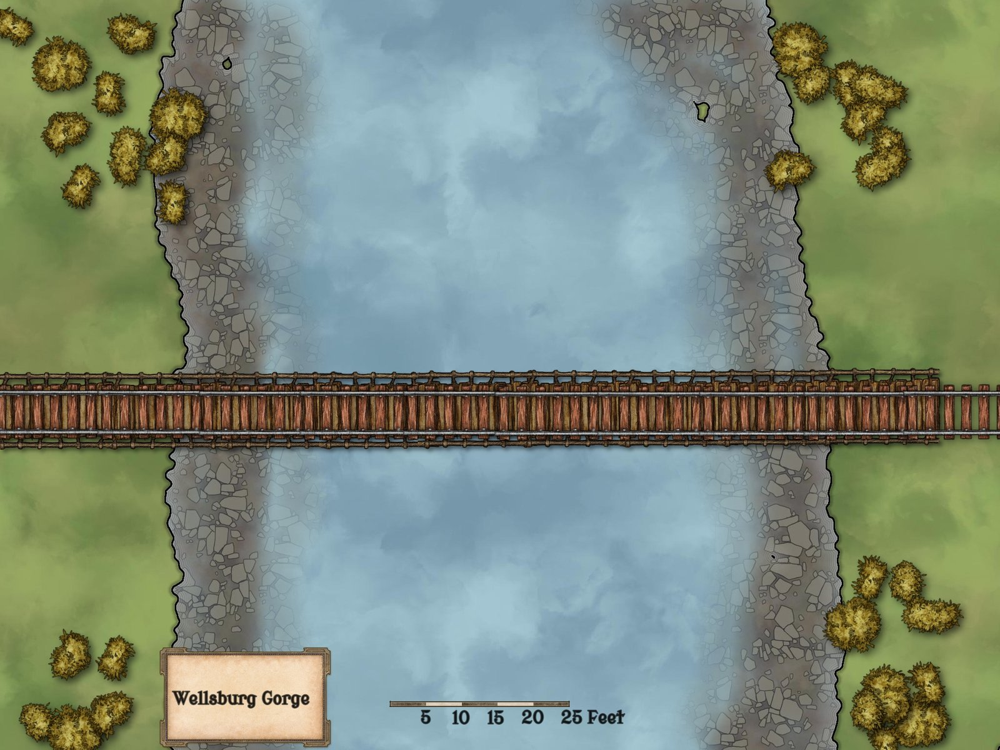

## Карта: ущелье Уэллсбург

*Надпись на карте: «Wellsburg Gorge» — ущелье Уэллсбург. Масштаб: 5–25 футов (около 2–8 м). Деревянный железнодорожный мост через реку между двумя каменистыми отмелями.*

*В книге эта карта — на с. 12.*
