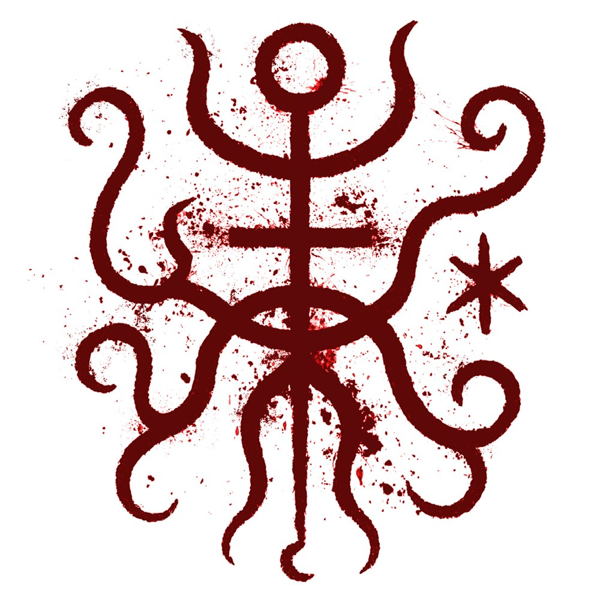

# Предисловие

Спасибо, что поддержали создание «Года Козла». Над книгой, которую вы держите в руках, целый год работали двенадцать вдохновенных авторов, двое измотанных редакторов и один потрясающий верстальщик. У нас было две цели. Во-первых, вывести из тени редко появляющееся божество Мифов Ктулху и разобраться в символах, темах и преданиях, из которых складывается человеческое представление об этой сущности. Во-вторых, дать авторам Miskatonic Repository возможность пройти редакционный путь, близкий к тому, что принят у профессиональных издателей настольных ролевых игр, и помочь им добиться ещё большего.

Свои замыслы присылали люди самого разного происхождения, представлявшие всё многообразие сообщества авторов Miskatonic Repository. Те, чьи заявки мы приняли в сборник, месяцами корпели над планами и текстами. Каждый сценарий прошёл четыре отдельные редакции и множество тестовых игр, прежде чем отправиться в вёрстку.

Так на свет появился целый зверинец историй о семье, самосовершенствовании, зачатии, мутации, творении и множестве других обличий Шуб-Ниггурат.

Меня глубоко тронуло то, что авторы решили принять участие в этом проекте. Я потрясён тем, какие кошмары им удалось вызвать к жизни. Для меня честь представить их вам на этих страницах.

— Хайнрих Д. Мур

**Йа, Шуб-Ниггурат!**  
**Йа, Чёрная Коза Чащоб с Тысячей Младых!**
