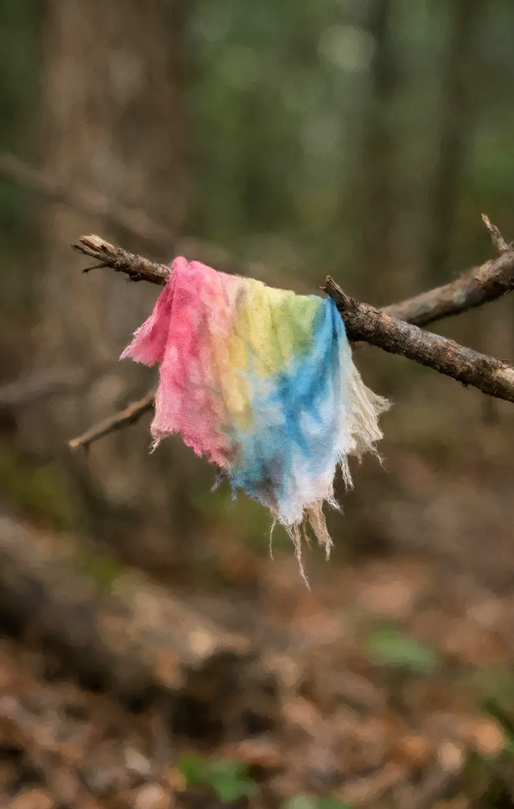

Позади Стэнли над кассой приклеен рисунок леса со словом «Дом» (раздатка 4, «Рисунок из бара»). У стойки сидит Сьюзан. Если сыщики не вошли следом за ней, перед ней уже несколько пустых пивных бутылок. Стэнли ставит рядом только что открытую, и она отпивает большой глоток.

Поначалу Сьюзан не отвечает сыщикам, а когда всё-таки заговаривает, становится ясно, что она сильно пьяна. Стэнли пресекает любые расспросы о пропавшей дочери: «Тяжёлый у неё день». О Беатрикс он пожимает плечами: может, она со Стариной Джо, а может, сбежала с его новой барменшей, Бёрди (сильно постаревшей Беатрикс). Если расспросить подробнее, он охотно расскажет следующее, но попросит заняться и исчезновением Старины Джо:

- Семь дней назад молодая женщина, назвавшаяся Бёрди, пришла устраиваться на работу. На собеседовании она как будто растерялась: не знала обычных коктейлей и не умела правильно наливать пиво.
- Бёрди принесла несколько «домашних сиропов» для коктейлей. Один Стэнли попробовал, и тот оказался таким вкусным, что всю неделю он добавлял его в напитки. Видимых следов молоко на нём не оставило, но он уже чувствует, что его тянет «домой», хотя сам ещё не понимает, почему.
- С тех пор, как появилась Бёрди, Старина Джо пропал. Стэнли волнуется за него, как за брата, который не вернулся домой.

Если спросить о рисунке за стойкой, Стэнли отмахнётся: подарок от матери, напоминание о счастливых походах. Проверка Психологии или другого социального навыка показывает, что он врёт. В конце концов он признается, что рисунок от Бёрди, а почему сказал про мать — сам не знает. После этого он выглядит сбитым с толку. На рисунке сыщики узнают конкретную дорогу на окраине города. Позвольте им пройти проверку Идеи и догадаться, что пропавшая может быть там: либо они уже поняли, кто такая Бёрди, либо решили, что Беатрикс и Бёрди сбежали вместе.

### …Это ты?

После рассказа Паркеров сыщики могут заподозрить местных бездомных и начать искать Старину Джо. На улице им попадается Беатрикс в облике пожилой женщины: на ней рваная футболка-тай-дай, волосы сильно тронуты сединой. Это та самая девушка, которую они ищут, но ни на описание, ни на её возраст она не похожа. Манерами и видом она скорее напоминает хиппи из движения нью-эйдж, чем похитительницу.

Если подойти, она отругает сыщиков за назойливость, назовёт «винтиками бетонной машины» и пригрозит наслать проклятие, если они не отстанут. Она собирается уйти; остановит её только успешная проверка социального навыка. Если расспросить её, скажет, что живёт в лесу с семьёй, среди деревьев, где все они почитают Мать… Природу. Последнее слово добавляет после паузы. Проверка Психологии показывает: она искренне считает лес своей семьёй. Она отрицает, что дружит со Стариной Джо, — явная ложь, — и с другими местными бездомными, но подскажет, что те часто бывают у Святой Моники, если сыщики ищут именно их. О пропавшей девушке будто ничего не знает и, по её словам, предпочитает одиночество среди деревьев.

Пока хранитель не готов перейти к кульминации, проследить за Беатрикс невозможно. Она пропадает до того, как сыщики успеют понять, куда она направилась, словно лес её проглотил. Остаётся лишь лоскут её футболки-тай-дай: яркий узор испорчен пятном от Молока единения. Прикосновение к ткани вызывает те же последствия, что и контакт с жидкостью.

