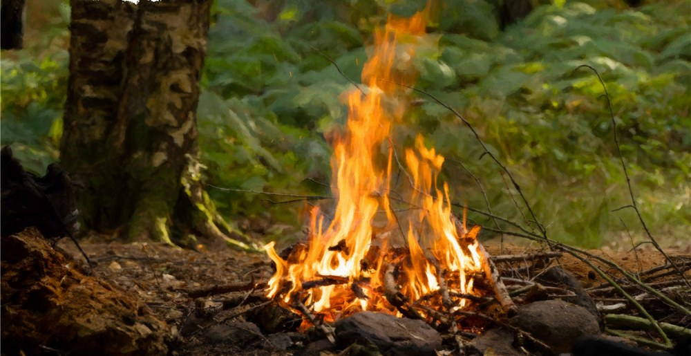

Вглядываясь в лица, сыщики узнают следующих горожан. Кроме них, здесь много других людей, в том числе немало бездомных, пропавших из столовой.

- **Уильям Фуллер.** Хозяин магазина «Локал Харвест» хлопочет над котелком на костре. На щеке у него лиловый шрам. Он рад сыщикам и приглашает выпить с ним (Молока единения).
- **Фелиция Залеска.** Сидит с людьми, которых прежде обслуживала в столовой Святой Моники, и помогает тем, кто из-за увечий уже не может пить из бутылочек, принять ещё Молока единения. Рука у неё сильно изменила цвет и болезненно вывернута. Она решительно пресечёт попытки ей помешать: «Это им же на пользу».
- **Стэнли Леонард.** Прибирает в лагере, собирает пустые бутылки. Сильно хромает на распухшую ногу. Будет рад, если сыщики помогут навести порядок.
- **Старина Джо.** Ходит среди горожан и бездомных, приветствуя каждого как давно потерянного друга. Охотно познакомит сыщиков с любым из присутствующих.
- **Джессика Хейнс.** Спит в спальнике. Видны только лицо и рука, согнутая под неестественным углом. По очертаниям спальника ясно, что остальное тело исковеркано так же. Как ни старайся, Джессика не проснётся.

Идиллию нарушают те, кто пьёт из пластиковых бутылочек такую же жидкость, какую сыщики уже могли видеть. После каждого глотка лицо кривится от отвращения и тут же расплывается в безмятежной улыбке, а конечности с хрустом выворачиваются и ломаются: локти гнутся назад, щиколотки проворачиваются, плечи вздымаются под нечеловеческим углом (потеря 1/1d4 рассудка). На вид это мучительно, но здесь никого не тревожит, а Беатрикс смотрит, как боль сплачивает её семью.

Тех сыщиков, кто уже соприкасался с Молоком единения, приветствуют словами «Мать здесь» и предлагают свежую бутылку. Они вправе отказаться. Если выпить по доброй воле, живот пронзает боль, словно глубоко вогнали нож. Но вместо ранения сыщик восстанавливает 1d3 ПЗ (даже сверх максимума). Даже у невредимого сыщика чудесным образом исчезают пятна на коже и старые шрамы.

Если снова подойти к старухе, Беатрикс предлагает бутылку Молока единения. Она не скрывает, что и есть та девушка, которую поручено найти. Если спросить, что в молоке, она отрицает всякий вред, даже пока расстёгивает блузку и наполняет ещё одну бутылку из покрытого синяками соска. Если спросить об увечьях её «семьи», Беатрикс удивится: «А разве это не семья? Разве не это и есть семья? Боль». Созданная ею «семья» смотрит в ответ запавшими глазами и широко улыбается.

