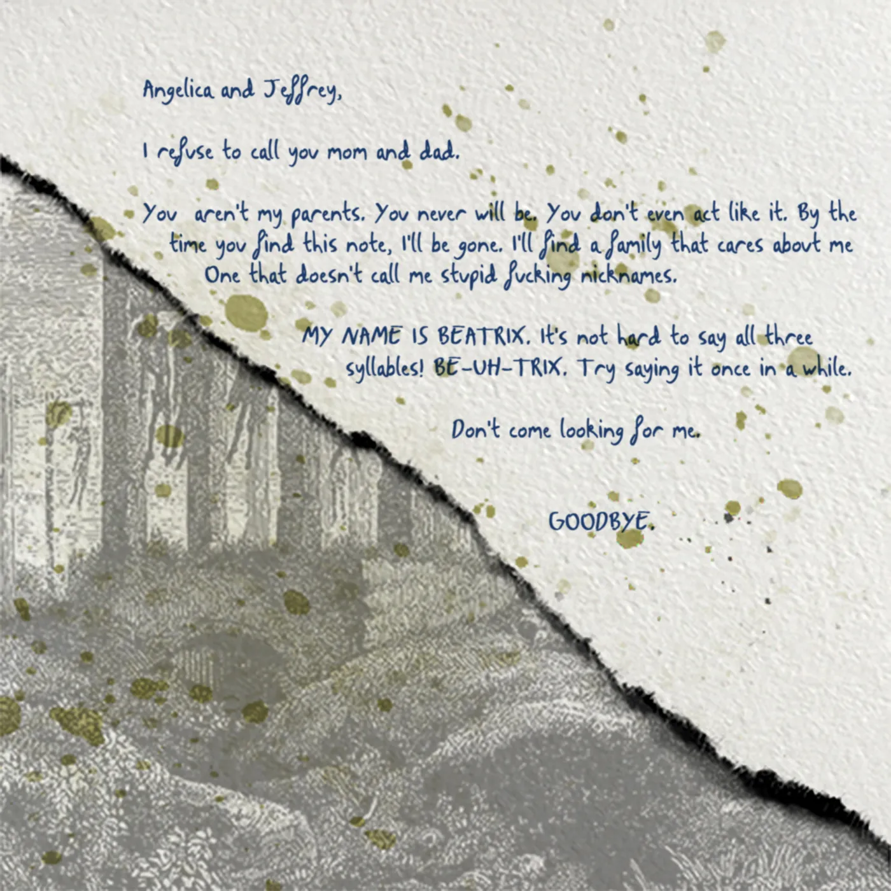

## Раздатки

> **Раздатка 1. Записка Беатрикс**
>
> Анджелика и Джеффри,  
> Я отказываюсь звать вас мамой и папой.  
> Вы мне не родители. И никогда не будете. Вы даже не ведёте себя как родители. Когда вы найдёте эту записку, меня уже не будет. Я найду семью, которой я не безразлична. Такую, которая не зовёт меня дебильными, на хрен, прозвищами.  
> МЕНЯ ЗОВУТ БЕАТРИКС. Не так уж трудно сказать все три слога! БЕ-А-ТРИКС. Попробуйте хоть раз.  
> Не ищите меня.  
> ПРОЩАЙТЕ.  
