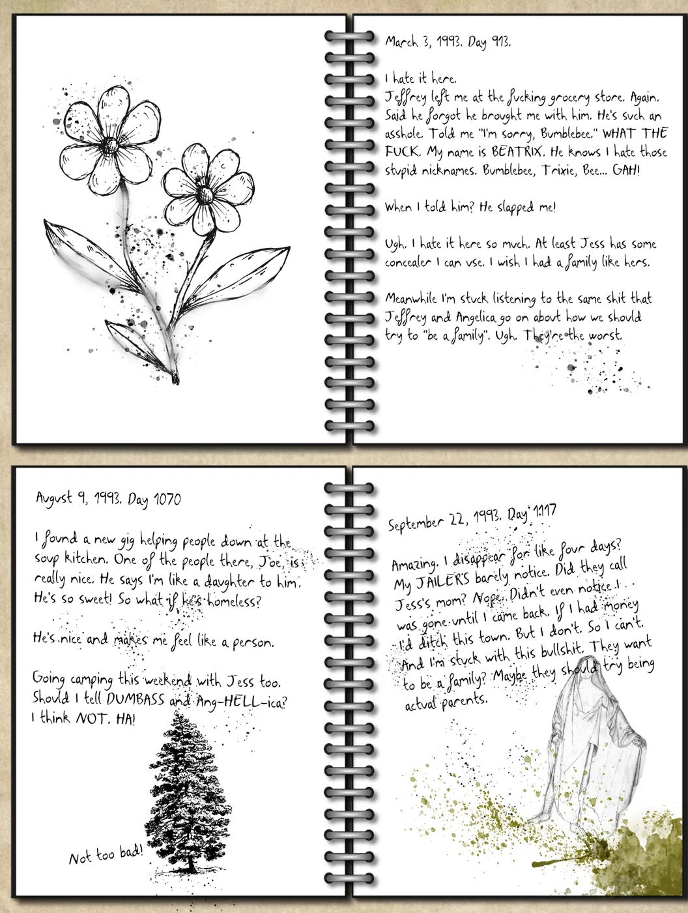

> **Раздатка 2. Дневник Беатрикс**
>
> 3 марта 1993 года. День 913.  
> Ненавижу это место.  
> Джеффри опять бросил меня в этом гребаном продуктовом. Сказал, что забыл, что взял меня с собой. Какой же он козёл. Сказал мне: «Прости, Бамблби». КАКОГО ХРЕНА. Меня зовут БЕАТРИКС. Он знает, что я ненавижу эти дурацкие прозвища. Бамблби, Трикси, Би… ГРР!  
> Когда я ему это сказала? Он дал мне пощёчину!  
> Фу. Как же я ненавижу это место. Хорошо хоть у Джесс есть тональник, которым можно замазать. Хотела бы я такую семью, как у неё.  
> А я тем временем слушаю одну и ту же фигню, как Джеффри и Анджелика твердят, что нам надо постараться «быть семьёй». Фу. Они худшие.  
>
> 9 августа 1993 года. День 1070  
> Нашла новую подработку — помогаю людям в бесплатной столовой. Один из тамошних, Джо, очень милый. Говорит, что я ему как дочь. Он такой славный! Ну и что, что он бездомный?  
> Он милый, и с ним я чувствую себя человеком.  
> В эти выходные иду в поход с Джесс. Сказать ТУПИЦЕ и Анж-АДО-лике? Ну УЖ НЕТ. ХА!  
> Неплохо!  
>
> 22 сентября 1993 года. День 1117  
> Потрясающе. Пропадаю где-то на четыре дня? Мои ТЮРЕМЩИКИ почти не замечают. Позвонили они маме Джесс? Неа. Даже не заметили, что меня не было, пока я не вернулась. Были бы деньги — свалила бы из этого города. Но денег нет. Значит, не могу. И я застряла с этой фигнёй. Они хотят быть семьёй? Может, им стоит попробовать быть настоящими родителями.  

*Прим. перев.:* номера дней в дневнике не совпадают с промежутками между указанными датами; ничего не пересчитано.
