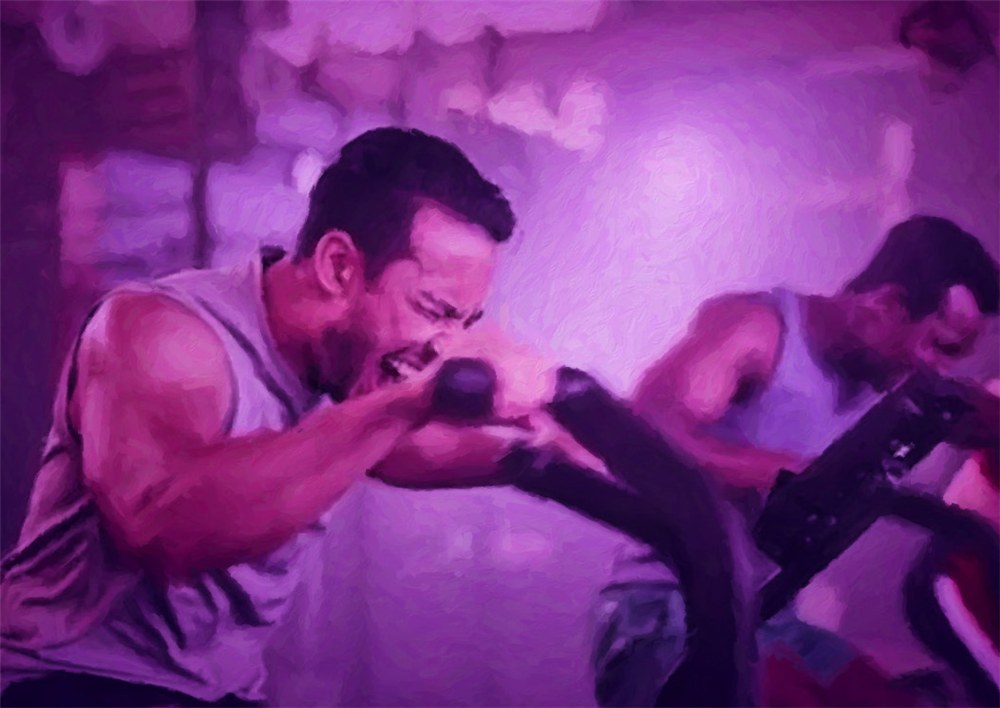
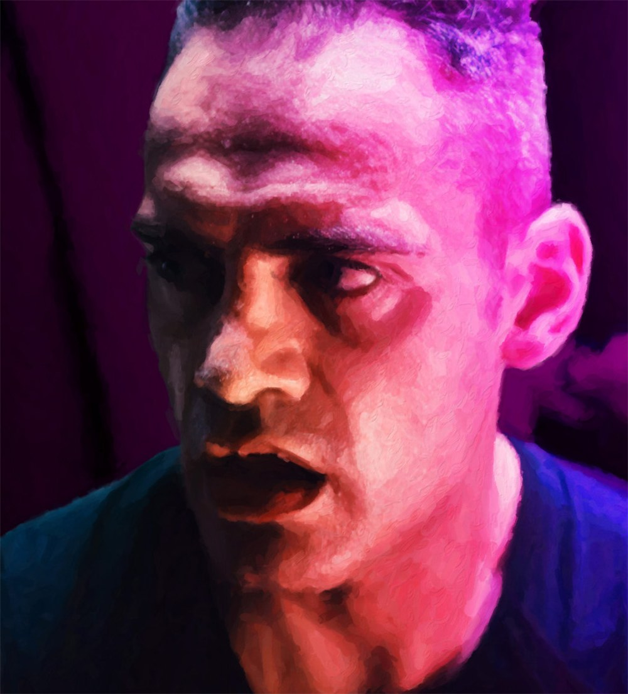

**Зацепка для отыгрыша:** Алексу важно, чтобы его считали лучшим, и страшно, что о нём забудут. Но даже Алекс подозревает неладное: уж слишком напористо спортзал GOAT рекламирует свою систему мотивации.

### Эш Дибра, 33 года, озеленитель и завсегдатай спортзала

Работяга Эш проводит в спортзале GOAT больше времени, чем дома. Цель одна: обратить на себя внимание Карли Барлоу, бывшей олимпийской спортсменки, а ныне тренера. Упрямый и самоуверенный Эш верит, что грубой силой и упорством можно добиться чего угодно, даже номера телефона Карли.

**Стимул GOAT:** добиться, чтобы Карли Барлоу, бывшая олимпийская спортсменка и нынешний тренер GOAT, хотя бы обратила на него внимание.

**Черты:** преданный, решительный, импульсивный, безнадёжный романтик.

**Зацепка для отыгрыша:** Эш постоянно ищет повод оказаться рядом с Карли и на каждой тренировке выкладывается ещё больше, лишь бы она заметила. Но даже Эш заметил, что кое-кто перестал ходить в GOAT без объяснений. Сестра Мира говорит: это тревожный знак, и ей всё больше не по себе.

### Киран Апте, 27 лет, специалист техподдержки

Киран разбирается в технике, но привык, что его недооценивают. Он мечтает накачаться, чтобы перестать быть «слабым звеном» в любой компании. Хрупкое сложение он с лихвой возмещает острым умом, находчивостью и растущей одержимостью самосовершенствованием в GOAT.

**Стимул GOAT:** перестать быть мишенью для насмешек из-за щуплого сложения и репутации ботаника; доказать, что первое впечатление обманчиво.

**Черты:** остроумный, наблюдательный, стеснительный, решительный без показухи.

**Зацепка для отыгрыша:** Киран вертится возле закрытых зон, проверяя не только двери, но и то, что ему сойдёт с рук. Любопытство порой доводит до неприятностей, особенно при таких строгих правилах, как в GOAT.

## Действующие лица

### Тэд Харт, 32 года

*Владелец и главный тренер спортзала GOAT.* Тэд служит Шуб-Ниггурат. Он тренировался в Германии с фанатами экстремального фитнеса, научившись отдавать боль в обмен на жизненную силу. Теперь он отнимает жизненную силу у посетителей GOAT. Его принцип: «Выживает сильнейший». По Тэду, процветать должны лишь сильные, а удел слабых — стать жертвой. Он верит, что приближает новую эру совершенства. Тэд почти не моргает: надпочечники работают на износ, всё тело постоянно начеку. Пальцы он сжимает в два пучка, похожих на козье копыто: смотреть на это больно, но сам Тэд не испытывает неудобства.

**Стимул GOAT:** стать любимцем среди избранных служителей Шуб-Ниггурат.

**Черты:** напористый, ревностный, умеет манипулировать людьми, харизматичный, безжалостный.

**Зацепка для отыгрыша:** хвалит тех, кто превзошёл себя. Проповедует «жертву» и «совершенство», словно духовные идеалы, и ненавязчиво намекает на награду за полную отдачу. Если усомниться в методах GOAT, объясняет, что без страдания не выйти за пределы человеческого.

### Карли Барлоу, 23 года

*Тренер занятий OBSESSION в спортзале GOAT.* Составляет программы тренировок, завоёвывала серебро на Олимпиаде в рывке и толчке, предана GOAT как никто другой. Карли охотно приносит слабых посетителей в жертву, чтобы заслужить благосклонность Шуб-Ниггурат.

