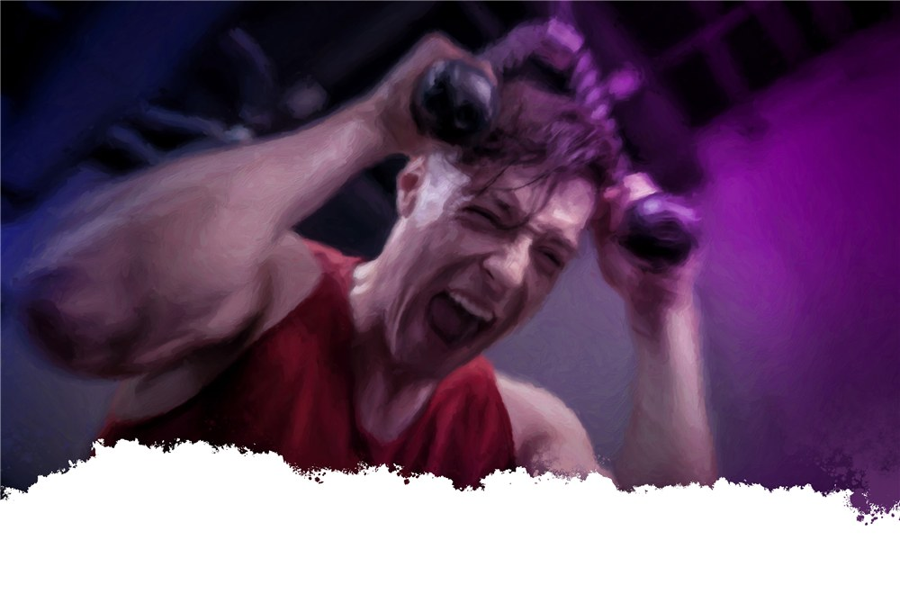

## Часть I. Смертельно уставшие

Сыщики впервые тренируются в спортзале GOAT. Тренер Карли Барлоу ведёт изнурительное занятие: не даёт участникам передохнуть, подгоняет их угрозами, замаскированными под мотивацию. Она объясняет, что такое очки OBSESSION, и рассказывает о закрытом занятии OBSESSION, которое ведёт главный тренер Тэд Харт. С ростом нагрузки сыщики замечают тревожные перемены: остальные становятся неестественно подтянутыми, а один из посетителей, Крис Кац, занимается без передышки. Напряжение нарастает: что, если за результатами GOAT стоит нечто тёмное?

### Алмазы рождаются под давлением

Карли Барлоу врывается в зал, разминаясь и растягиваясь прямо на ходу. Каждому сыщику и остальным участникам она вручает листовку (раздатка 1, «Листовка спортзала GOAT») и представляет спортзал:

> У огромного сенсорного экрана стоит женщина с бугрящимися мышцами. Она допивает чёрный протеиновый коктейль. На её спортивной майке спереди и сзади написано GOAT и «ТРЕНЕР». «Доброе утро! Готовы заработать очки OBSESSION? Сейчас посмотрим, кому это действительно надо. Кто у нас сегодня станет GOAT?»

Карли закрепляет на каждом трекер ME-ZONE и раздаёт резинки для разминки. На вопрос про занятие OBSESSION отвечает: «Только по приглашению, и его ещё нужно заслужить. Ведёт главный тренер Тэд Харт. Выложитесь как следует — и жизнь уже не будет прежней!»

Растягивая резинку, Карли объясняет, что сегодня отслеживают пульс, потраченные калории и очки OBSESSION, и показывает упражнения для разминки. Будет три этапа: каждый испытывает либо СИЛ, либо ЛВК, либо ВЫН. На каждом этапе сыщик может пройти проверку соответствующей характеристики и заработать очки OBSESSION, которые заносятся в энергосистему. Таблица 1 показывает, какой нагрузке соответствует результат проверки и сколько очков сыщик зарабатывает на каждом этапе. Результаты видны всем на огромном табло.

> **Пример.** На этапе 1 Холли прошла проверку СИЛ с обычным успехом и получила 3 очка OBSESSION. На этапе 2 у неё чрезвычайный успех проверки ЛВК, за который она получила 7 очков. На этапе 3 она провалила проверку ВЫН и заработала только 1 очко. Всего за тренировку — 11 очков OBSESSION.

- **Разминка.** Два круга: 20 ккал на безмоторной дорожке AssaultRunner, 15 выпадов в ходьбе, 10 бёрпи, 5 приседаний.
- **Этап 1 (СИЛ), силовой.** Приседания со штангой на спине: 12, 10, 8 повторов, затем максимум повторов с весом своего максимума на один повтор.
- **Этап 2 (ЛВК), интервальное кардио.** 8 × 200 м на AssaultRunner, 8 × 250 м на SkiErg, 8 × 400 м на BikeErg или 8 × 300 м на гребном тренажёре. Между отрезками отдых по 30 секунд.
- **Этап 3 (ВЫН), 20 минут.** Как можно больше раундов (AMRAP), «Ненавижу восьмёрку»: 8 подтягиваний, 8 подъёмов корпуса, 8 отжиманий, 8 толканий саней.
