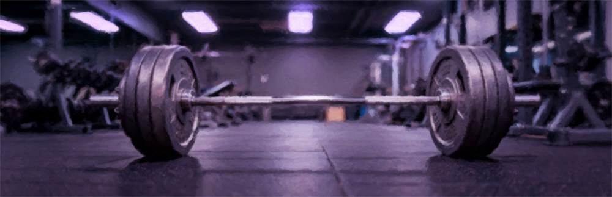

| Результат | Очки OBSESSION | Энергосистема (нагрузка) |
|---|---:|---|
| Критический успех | 10 | Мгновенная — работа на пределе возможностей. |
| Чрезвычайный успех | 7 | Анаэробная и аэробная — дыхание сбивается, трудно произнести подряд больше пары слов. |
| Трудный успех | 5 | Аэробная — дыхание сбивается, но можно произнести фразу из четырёх и более слов. |
| Успех | 3 | Аэробная — мышцы разогреты, выступает лёгкий пот. |
| Провал | 1 | Лёгкая — упражнения в удовольствие. |
| Крах | 0 | Покой — состояние, обычное для отдыха. |

Во время тренировки Карли следит за участниками и рявкает на отстающих:

- «Хочешь печенья с шоколадом? Отработай!»
- «Похалтуришь — сам себе не простишь!»
- «Завтра сам себе спасибо скажешь!»

Карли подгоняет всё жёстче. Хранитель может спросить, хотят ли сыщики повторять проверки или тратить Удачу, чтобы выдержать нагрузку.

После каждого этапа есть две минуты передышки, чтобы поговорить. Но Крис Кац продолжает заниматься, не обращая ни на кого внимания. Пусть сыщики пройдут проверку МОЩ. Сыщик с наивысшей степенью успеха слышит рядом с Крисом шёпот. Голос не его и не кого-то из стоящих рядом: «Ещё. Мне нужно ещё. Прими боль. Принеси мне жертву».

Если сыщики оглядятся, они заметят, что над панелью каждого тренажёра GOAT выгравирован мускулистый козёл (раздатка 2, «Логотип спортзала GOAT»). Успешная проверка ИНТ позволяет после тренировки заметить малозаметные перемены в остальных участниках: те стали сильнее, подтянутее, с более рельефной мускулатурой. Похоже, больше никому это не бросается в глаза.

### Снова и снова

Вводное занятие давно закончилось, а Крис Кац и не думает останавливаться. Он отмахивается от любых попыток поговорить. В ближайшие дни сыщики раз за разом видят его в зале за тренировкой — он здесь как часть обстановки. Сыщики могут познакомиться с его обеспокоенной подругой Клэр Мэдден, которая тоже здесь занимается. Карли Барлоу всегда готова провести тренировку, стоит ей допить чёрный протеиновый коктейль, а тот у неё, кажется, всегда под рукой.

Главное — вовлечь сыщиков в новые тренировки: по той же трёхэтапной схеме или по одному из вариантов ниже. Поощряйте игроков тратить Удачу, повторять проверки и описывать, как сыщики превосходят себя.

> **Дополнительная тренировка 1. «Железная пирамида»**
>
> **Разминка.** Два круга: 500 м на гребном тренажёре, 20 махов гирей, 15 отжиманий, 10 приседаний без веса.
>
> **Этап 1 (СИЛ), силовой.** Пирамида становой тяги: 5 повторов с 60%, 5 с 70%, 3 с 80%, максимум повторов с 85%.
>
> **Этап 2 (ЛВК), интервальное кардио.** 10 спринтов по 150 м на AssaultRunner, отдых по 20 секунд между ними.
>
> **Этап 3 (ВЫН), 18 минут.** Как можно больше раундов (AMRAP), «Перемол»: 12 прыжков на тумбу, 12 бросков медбола в мишень (9 кг), 12 взятий гири на грудь с жимом, бег 200 м.

> **Дополнительная тренировка 2. «Пот и жертва»**
>
> **Разминка.** Два круга: 20 ккал на BikeErg, 15 выпадов в ходьбе, 10 тяг гири к подбородку из стойки сумо, 10 «скалолазов».
>
> **Этап 1 (СИЛ), силовой.** Лестница жима лёжа: 12 повторов с 65%, 10 с 70%, 8 с 75%, максимум повторов с 80%.
>
> **Этап 2 (ЛВК), интервальное кардио.** 6 раундов: 250 м на SkiErg, 10 бёрпи, 30 секунд отдыха.
>
> **Этап 3 (ВЫН), 20 минут.** Как можно больше раундов (AMRAP), «Горнило»: 15 приседаний с выбросом гантелей вверх, 12 подъёмов ног до перекладины, 10 жимовых швунгов, 250 м на AssaultRunner.

С каждым днём тренировки дают ощутимый результат: лучше самочувствие, больше мышц или выше выносливость. У сыщика, набравшего больше всех очков OBSESSION за день, заметно меняется телосложение: он становится выше, грудные мышцы обретают рельеф, одежда становится велика и так далее. ВНЕ этого сыщика навсегда увеличивается на 5. Предложите всем записать физические перемены в листах сыщиков.

Если время позволяет, дайте игрокам пройти этот цикл два или три раза, прежде чем перейти к части II.
