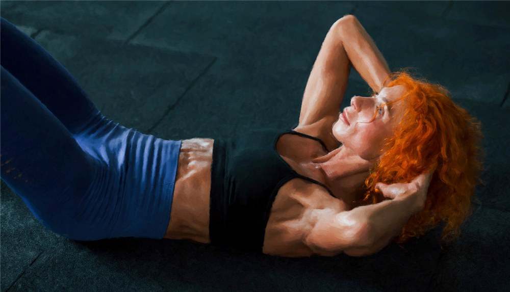

### Встреча в «Индалдженс»

Если сыщики соглашаются встретиться в местной кофейне «Индалдженс» или предлагают другое место, Клэр рассказывает всё. Её всё сильнее тревожит, что люди пропадают после занятий OBSESSION в подвальной студии. Она вытаскивает из сумки мятую листовку, такую же, как у сыщиков (раздатка 1, «Листовка спортзала GOAT»). На ней написано: «Только по приглашениям».

Только вчера, говорит Клэр, она поделилась тревогой с Крисом Кацем. Криса смущало происходящее в GOAT, и он подозревал, что пропавшие вовсе не бросили тренировки, как утверждали тренеры. Он даже говорил, что записал кое-что в тренировочном дневнике. Тот остался в его шкафчике. «Это было вчера. А теперь он мёртв». Клэр пододвигает по столу ключ. На нём номер 103. «Я сняла его с Криса… пока Карли меня не оттолкнула, — шепчет она, обводя глазами зал. — В шкафчике найдёте всё, что он знал. А если нет, значит, они прячут что-то у себя в кабинете. Удачи. И спасибо».

### Обыск раздевалки

Пришли ли сыщики сами или по просьбе Клэр Мэдден, в раздевалке они видят кабинки, скамью посередине, шкафчики вдоль стены и свежие полотенца, аккуратно сложенные в открытом шкафу.

Ключ Клэр открывает шкафчик Криса Каца № 103. Внутри полотенце, гель для душа, лосьон после бритья и два мятых листка. Первый — распечатка публикаций из соцсетей (раздатка 3а). На втором (раздатка 3б, «Тренировочный дневник») есть текст на неизвестном языке. Всякий, кто читает его или слышит, как его читают вслух, проходит проверку МОЩ. При провале в голове вспыхивают яркие, мимолётные видения, объясняющие, отчего Крис начал терять душевное равновесие. Зачитайте:

> Мышцы сводит. Слова и образы захлёстывают тебя: люди тренируются через боль, пока тело не сдаёт. Крики, рвущаяся плоть и голоса: «Сломайся ради меня. Разорвись ради меня. Страдай ради меня». Мышцы вздуваются. Кожа лопается. Хлещет кровь. Голос продолжает: «Преобразись. Утоли мой голод. Отдай мне всего себя!»

Нужна проверка рассудка (потеря 1d4/1d8). Проваливший её сыщик понимает желание Криса довести своё тело до совершенства. Ему тоже хочется стать совершенным для GOAT. Он невольно начинает выполнять одно из следующих упражнений и не прекращает 1d4 минуты, если только его не остановят силой:

| 1d4 | Непроизвольное упражнение |
|---|---|
| 1 | Отжимания |
| 2 | Подъёмы корпуса |
| 3 | Бёрпи |
| 4 | Приседания без веса |

*Прим. перев.:* здесь, как и на с. 29, в оригинале встречается написание Clare вместо Claire.

### Обыск кабинета GOAT

Кабинет заперт: чтобы открыть дверь, нужна проверка Взлома или трудная проверка СИЛ. Внутри множество брошенных грязных стаканов со следами чёрного коктейля Карли Барлоу. Если кто-то рискнёт попробовать, это прогорклое молоко странного цвета, пахнущее потом. На вкус — ровно то, чего можно ожидать. Здесь же лежит «Ежедневник тренировок», написанный на жутком нечеловеческом языке (раздатка 4). Сыщик, который читает план или слышит, как его читают, не понимает ни слова, но чувствует исходящую от написанного волну неукротимого желания. Нужна трудная проверка МОЩ, иначе он теряет сознание. Если товарищи не вмешаются, тренеры отнесут найденного сыщика прямиком в подвальную студию и прикуют к тренажёру (см. часть III в оригинале).

*Прим. перев.:* ссылка ведёт к части III, но пленение и тренажёры описаны в части IV, на с. 35–36.

Застав сыщика в кабинете в сознании, тренеры действуют силой: пытаются захватить шею, отчего можно потерять сознание. Проведите встречную проверку СИЛ. Если сыщик выигрывает и отбивается, тренеры грозятся вызвать полицию, если сыщики не спустятся с ними в подвальную студию, где можно будет всё уладить. Если спросить о языке Мифов, на котором написан план, тренеры лгут, что это древнеисландский.

Если сыщики остались незамеченными, они находят чертёж подвальной студии. Поверх плана нанесены ритуальные схемы, а посередине нацарапано: «ОНА ГОЛОДАЕТ В ЛОЩИНЕ» (раздатка 5, «План подвальной студии»). Это намёк на присутствие Шуб-Ниггурат в студии.
