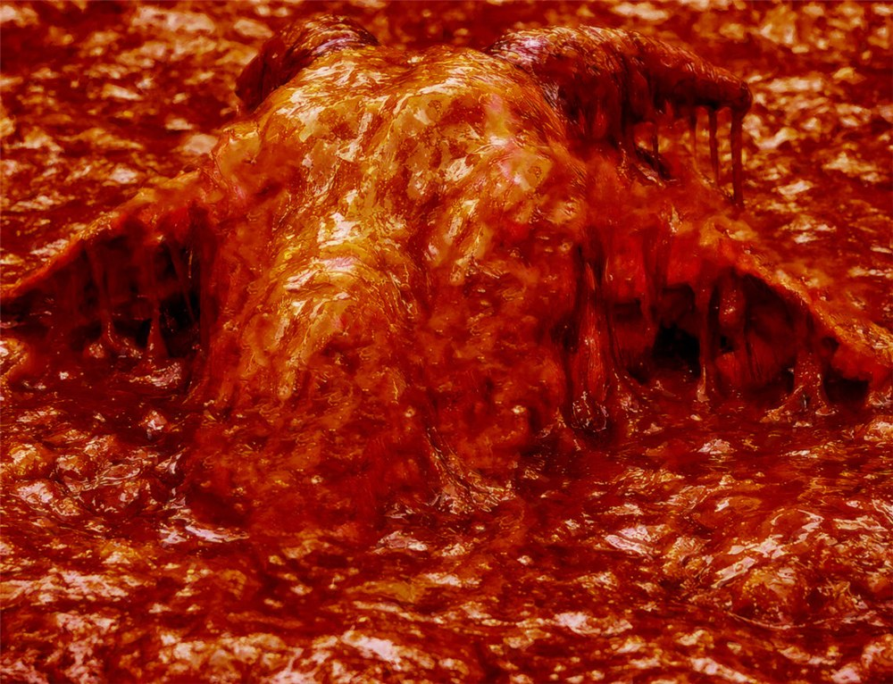

## Часть IV. Одержимость

Подвальная студия — место ритуала. Тренеры проводят здесь жертвенные тренировки, чтобы накормить Шуб-Ниггурат. Пропавших посетителей приковывают к заколдованным тренажёрам и заставляют заниматься до смерти. Они стареют на глазах, продолжая распевать, пока тело сдаёт. Каждый повтор питает живую, разрастающуюся массу с козьей мордой в центре зала.

Выясняется, что тренеры Тэд Харт и Карли Барлоу получают противоестественную жизненную силу в обмен на жертвы Чёрному Козлу. В финале хранителю стоит ставить игроков перед непростым выбором: спасать жертв, расправиться с тренерами или напасть на чудовищную лужу плоти. В бою пойдут в ход снаряды из спортзала; сыщики будут ломать тренажёры, освобождать пленников и отбиваться от щупалец Шуб-Ниггурат, пытающихся их поглотить. Чем больше вреда нанесут сыщики, тем ближе конец власти GOAT и его совершенства через боль.

### Величайший всех времён

Занятие OBSESSION проходит в подвальной студии, закрытой от обычных посетителей и посторонних. На цифровых табло горит: «Совершенство сегодня — или смерть завтра». Под ними идёт извращённая тренировка на исковерканных тренажёрах. На каждом выгравирован логотип GOAT (раздатка 2, «Логотип спортзала GOAT»). С каждым мучительным повтором, который выполняют пропавшие посетители, логотип пульсирует всё ярче.

Пленников не узнать. От боли они кричат и стареют на глазах. Их голоса сливаются в распев: «Мы отдаём тебе наш пот, нашу кровь, наши жизни, о Мать Совершенства».

На отдельном огромном экране — биометрические показатели: по ним видно, кто из пленников может умереть следующим. Умирающий стареет противоестественно быстро: кости крошатся от нехватки кальция, мышцы усыхают, перестав удерживать воду. Тренеры снимают оковы с исковерканных тел и бросают их в чудовищную лужу жидкой плоти в центре зала. Это кормовая яма Шуб-Ниггурат. При каждой новой жертве из пузырящейся ряби проступает козья голова и подаётся вперёд.

### Как найти подвальную студию

Сыщики могут попасть в студию тремя путями. Их могли пригласить, если они набрали достаточно очков OBSESSION. Их могли лишить сознания при обыске кабинета (см. часть II, «Обыск кабинета GOAT»). Наконец, они могли тайком проникнуть в зал, узнав, где будет занятие. Пробравшиеся в зал слышат из подвала низкие басы. Проверка Слуха позволяет различить распевы и крики боли. Незаметно войти в подвальную студию можно при успешной проверке Скрытности. Внутри можно ненадолго укрыться за исковерканными тренажёрами.

Захваченные после обыска кабинета приходят в себя на тренажёре. Они снова и снова выполняют то упражнение, за которое набрали меньше всего очков OBSESSION за весь сценарий. Чтобы выйти из транса и действовать по своей воле, нужна успешная проверка МОЩ. Иначе сыщик присоединяет голос к распеву других пленников: «Ломайся, рвись, страдай, я преображусь, утолю твой голод, отдам тебе всего себя!»

### Выкладывайся или умри

Когда все сыщики оказываются в подвальной студии, по своей воле или нет, чудовищная мясистая лужа в центре зала оживает, пузырясь. Она похожа на корчащуюся, разрастающуюся утробу из плоти и сухожилий. В ней повсюду мокнущие рты, смятые гантели, отростки вроде костей, клочья волос и обувь прежних жертв. Из жидкой плоти то поднимается, то уходит под поверхность козья голова. Запах такой, словно в сауне забыли спортивную сумку, а в ней протухло животное.

Это зрелище требует проверки рассудка (потеря 1d4/1d8). Во время приступа безумия сыщика охватывает желание предстать перед Шуб-Ниггурат в безупречной физической форме. Он непроизвольно начинает выполнять одно из следующих упражнений и продолжает 1d6+1 раундов:

| 1d4 | Непроизвольное упражнение |
|---|---|
| 1 | Отжимания |
| 2 | Подъёмы корпуса |
| 3 | Бёрпи |
| 4 | Приседания без веса |
