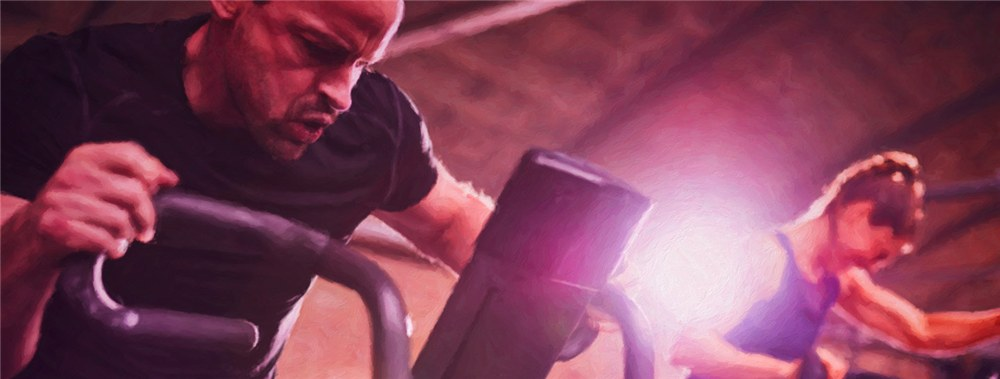

Сыщики, сохранившие самообладание, узнают в пленниках пропавших из записей Криса Каца. Видно также, что прикованные к тренажёрам совершенно не воспринимают происходящего вокруг.

В следующие раунды каждый из прикованных теряет ПЗ. Погибших бросают в яму с плотью. Если сыщики не вмешаются, удерживаемые в зале посетители гибнут в конце следующих раундов:

- Раунд 2 — Джо Стивенс.
- Раунд 3 — Амарт Сингх.
- Раунд 4 — Луис Монтене.
- Раунд 5 — Рене Такахаси.
- Раунд 6 — Элиса Ромеро.

Когда погибнет первый, зачитайте:

> Пленники движутся за пределами человеческих возможностей. Их нездешний распев переходит в крик боли: один из них испускает последний вздох и падает лицом вниз. Тело дёргается. Тренер снимает оковы, подхватывает тело, как нагруженную штангу, и бесцеремонно бросает к краю мясистой лужи в центре зала.

Чтобы оторвать пленника от заколдованного тренажёра, нужна проверка СИЛ или ЛВК. При успехе зачитайте:

> Посетитель падает на пол, ошеломлённый, испуганный, всё ещё в оковах. Он кричит и кричит, не в силах оправиться от того, что творится с его телом и разумом. Он пытается сбежать из зала и готов на всё, лишь бы сорвать оковы.

Захваченные сыщики, сами прикованные к тренажёрам, приходят в себя посреди упражнения при успешной проверке МОЩ. Проверку можно повторять каждый раунд. При её провале нужна проверка СИЛ, ЛВК или ВЫН — в зависимости от навязанной нагрузки. При провале и этой проверки сыщик получает 1d4 урона.

### Разоблачены

Как только сыщиков замечают — их привели пленниками, они пришли на занятие добровольно или сами себя выдали, — главный тренер Тэд Харт приветствует их на OBSESSION и принимается излагать свой злодейский замысел:

- Спортзал GOAT — храм и образец для всемирной сети.
- Поклонение на занятиях OBSESSION и плоть принесённых там жертв питают Чёрного Козла Шуб-Ниггурат.
- За преданность тренеры получают вечную молодость и совершенную физическую форму. Им позволено олицетворять лучшее в человечестве: только такие экземпляры рода людского достойны служить их жуткой госпоже.

В конце он восклицает: «GOAT — МОЙ ХРАМ! Шуб-Ниггурат, приношу тебе эти совершенные жертвы!» Карли Барлоу бросается на сыщиков с гантелью. Тэд перехватывает любого, кто пытается освободить пленников.

### Что нужно сделать

Сыщикам предстоит непростое дело: справиться с чудовищной мясистой лужей, остановить Тэда Харта и Карли Барлоу и по возможности не дать погибнуть другим посетителям. Варианты один труднее другого:

- Вступить в бой со всеми, включая тренеров.
- Попытаться уничтожить заколдованные тренажёры.
- Попытаться уничтожить чудовище, растущее в мясистой луже.

В схватке сыщики могут использовать импровизированное оружие и всё спортивное снаряжение, какое окажется под рукой. Предложите игрокам описать, что именно хватают сыщики: гантели, блины от штанги, набивные мячи. В зависимости от предмета урон обычно составляет от 1d4 до 1d6+БкУ.

Комплекция каждого заколдованного тренажёра — 2. Любая атака, наносящая не менее 10 урона, снимает 1 очко. Когда тренажёр уничтожен, прикованный к нему человек выходит из транса. Как сказано выше, пленника можно попытаться освободить и не ломая тренажёр, но оковы всё равно придётся снять или сломать.

Если сыщики подойдут к мясистой луже слишком близко, масса сгустится в чудовищное отродье и попытается схватить их покрытым шерстью щупальцем и пузырящейся козьей головой.
