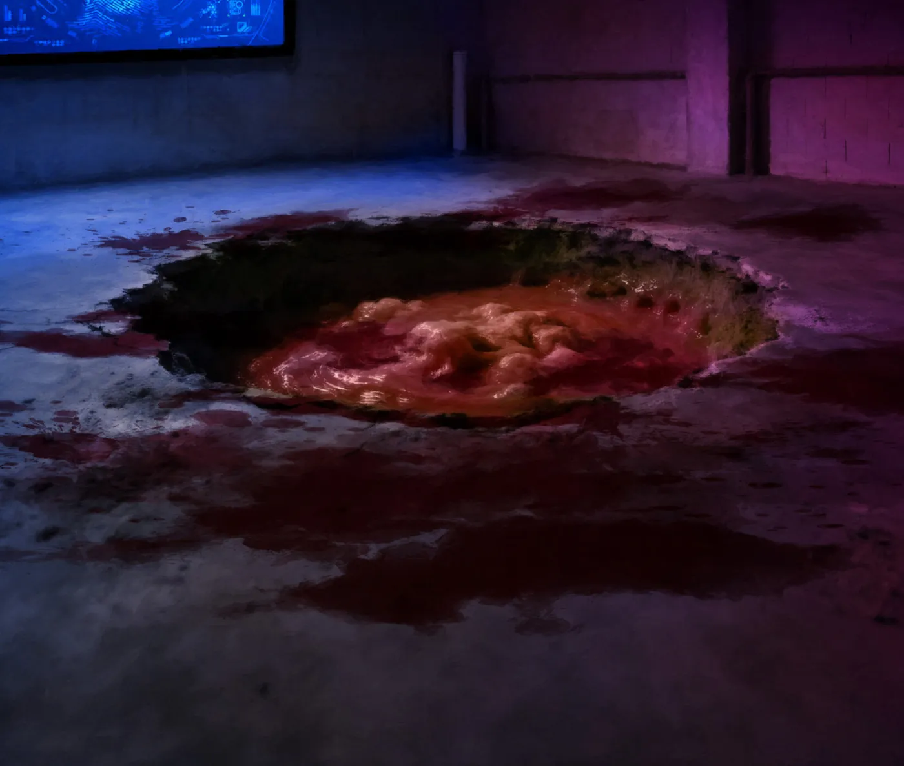

### Мясистая лужа

*Кормовая яма Шуб-Ниггурат.*

```stat
СИЛ 280   ВЫН 260   ТЕЛ 200   ЛВК 80   ИНТ 70
ВНЕ —     МОЩ 120   ОБР —     Рассудок —   ПЗ 57
БкУ: +7d6; Комплекция: 8; Скорость: 6; ПМ: 12; Удача: —
Атак за раунд: 2 (щупальца и пасти)
Кормовая яма может атаковать две отдельные цели или обрушить обе атаки на одного противника. Она бьёт длинными мускулистыми щупальцами, мечущимися ложноножками и отверстиями с человеческими зубами, которые открываются и закрываются по всей её подвижной массе.
Ближний бой (щупальце) 85% (42/17), урон 2d6 + захват
Укус (пасть) 65% (32/13), урон 1d6+7d6
Сокрушение плотью (удар по площади) 60% (30/12), урон 1d10 всем целям в радиусе примерно 3,3 м (нужна успешная проверка ЛВК, чтобы не упасть)
Броня: нет
Особые способности: противоестественная регенерация, скользкое от крови тело, блеяние боли (речь Мифов); см. ниже
```

*Прим. перев.:* ПЗ 57 (по ВЫН + ТЕЛ — 46), ПМ 12 (по МОЩ — 24), БкУ +7d6 и Комплекция 8 (по СИЛ + ТЕЛ — +5d6 и 6) оставлены как в оригинале.

#### Противоестественная регенерация (особая способность)

Кормовая яма восстанавливает 1d6 ПЗ каждые 2 раунда, впитывая плоть, пот или брошенный спортивный инвентарь. Поглотив живого человека, она мгновенно восстанавливает 10 ПЗ.

#### Скользкое от крови тело (особая способность)

При попадании в ближнем бою с вероятностью 50% кормовая яма брызгает едким потом. Атакующий должен преуспеть в проверке ЛВК; иначе получает 1d4 урона и тратит следующее действие на рвотные позывы.

#### Блеяние боли (речь Мифов)

Раз за схватку кормовая яма может издать жуткий распев, похожий на козье блеяние. Все, кто слышит его, проходят проверку рассудка (потеря 1/1d8).
